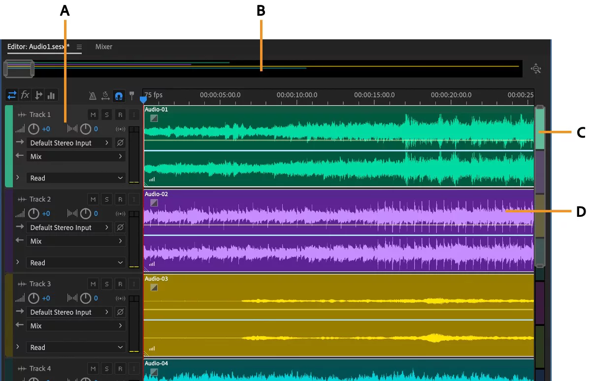
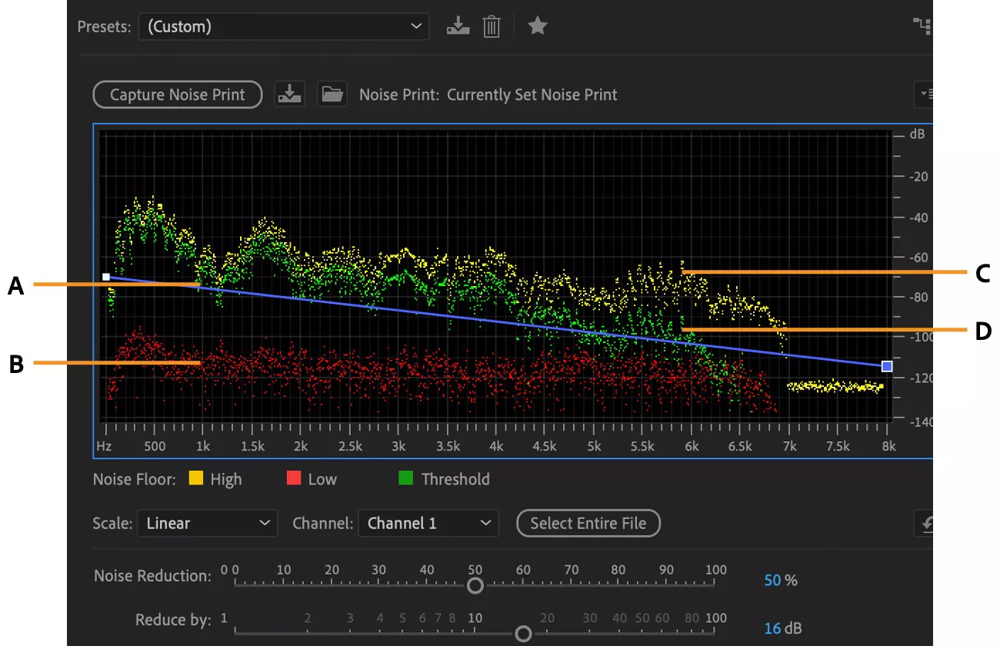
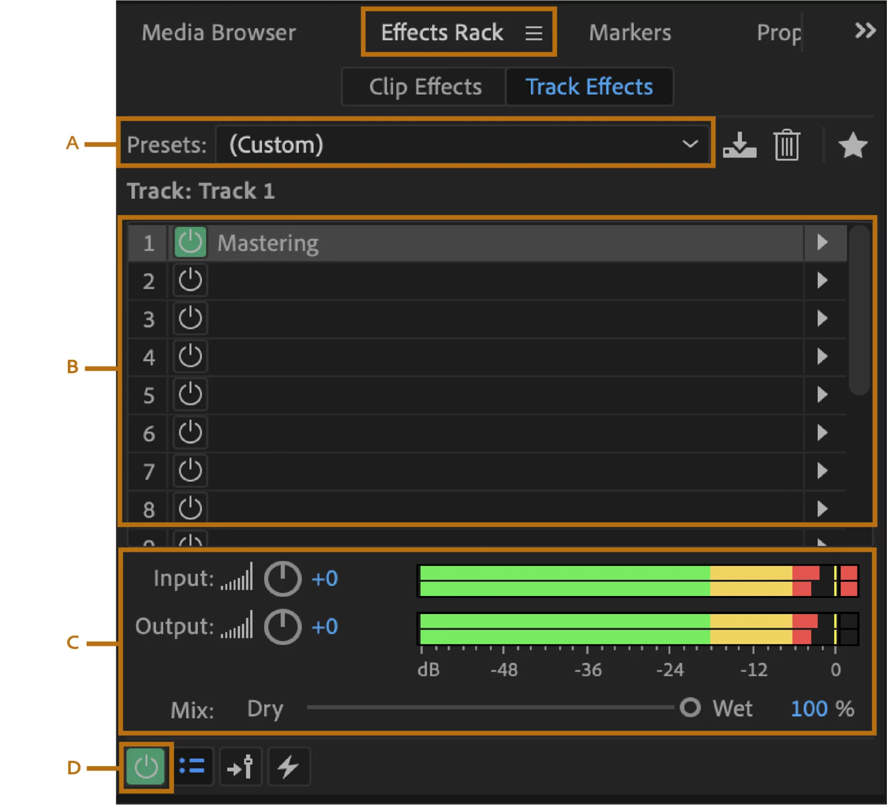
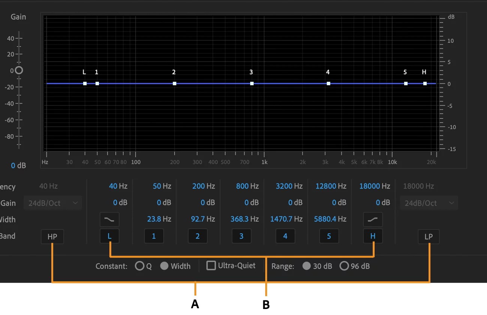
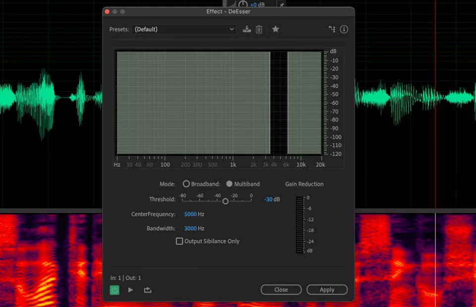
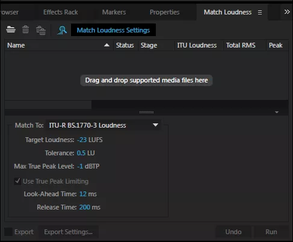
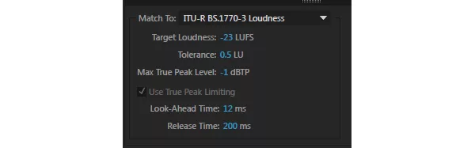

# از صدای خام تا پادکست حرفه‌ای
### راهنمای کامل ادیت و میکس با Adobe Audition

### راهنمای نشانه‌های داخل آموزش

  <kbd class="audition-key">R</kbd>کلید یا دکمه‌ی داخل برنامه (بسته به توضیح)
   Recordشروع ضبط
   Stopتوقف

> **راهنمای نشانه‌ها:** کلیدهای کیبورد با قاب برجسته مثل <kbd class="audition-key">Ctrl</kbd> نشان داده می‌شوند؛ نام دکمه‌ها و گزینه‌های داخل Audition داخل قاب ساده می‌آیند. فلش سبز → مسیر حرکت در منوها را نشان می‌دهد. شکل‌های این صفحه برای تشخیص کنترل‌ها هستند؛ برای جای دقیق هر گزینه، توضیح همان مرحله را دنبال کن.

اگر پادکست ضبط می‌کنی اما بعد از ادیت هنوز صدایت آن‌طور که می‌خواهی شنیده نمی‌شود، این راهنما کمک می‌کند قدم‌به‌قدم بهترش کنی. نشانه‌های «خام» بودن صدا این‌هاست:

- صدا خشک، بی‌عمق یا تیز شنیده می‌شود.
- بعضی جمله‌ها بلندتر و بعضی آرام‌ترند.
- موزیک یا روی صدا می‌افتد یا اصلاً شنیده نمی‌شود.
- فایل نهایی با پادکست‌های حرفه‌ای فاصله دارد.

این راهنما بر اساس تجربه‌ی ادیت و میکس یک اپیزود حدوداً یک‌ساعت‌و‌ربع نوشته شده؛ از ضبط و تمیزکاری تا میکس و خروجی. اشتباه‌ها و راه‌حل‌هایی را هم آورده‌ام که در طول کار به آن‌ها رسیدم. نتیجه یک مسیر مشخص است که قدم‌به‌قدم می‌روی، با عددهای دقیق و با توضیح اینکه **هر کار چرا انجام می‌شود**. توضیح داده‌ام هر تنظیم چه اثری دارد تا اگر میکروفون، اتاق یا جنس صدایت فرق داشت، بتوانی عددها را با گوش خودت تغییر بدی.

> **یک قول:** لازم نیست از قبل چیزی درباره‌ی طراحی صدا بدانی. اگر بلدی یک فایل صوتی را در Audition باز کنی و بخشی از آن را برش بزنی، برای شروع کافی است. بقیه‌ی کار را در همین راهنما یاد می‌گیری.

---

## فهرست

1. [این آموزش برای کیست و چه نتیجه‌ای می‌گیری؟](#s1)
2. [چه چیزهایی لازم داری؟](#s2)
3. [نقشه‌ی راه: ترتیب کارها و دلیل آن](#s3)
4. [مفاهیم پایه به زبان ساده](#s4)
5. [مرحله ۱: ضبط درست](#s5)
6. [مرحله ۲: ساخت سشن استریو و قالب](#s6)
7. [مرحله ۳: تمیزکاری](#s7)
8. [مرحله ۴: برش و چیدن](#s8)
9. [مرحله ۵: زنجیره‌ی افکت صدای راوی](#s9)
10. [مرحله ۶: موزیک پس‌زمینه](#s10)
11. [مرحله ۷: افکت‌های صوتی](#s11)
12. [مرحله ۸: مستر](#s12)
13. [مرحله ۹: Mixdown، تنظیم بلندی و خروجی](#s13)
14. [مرحله ۱۰: گوش‌دادن نهایی و انتشار](#s14)
15. [گردش کار هر اپیزود](#s15)
16. [تمرین عملی: اولین بار را با یک نمونه‌ی کوتاه انجام بده](#s16)
17. [عیب‌یابی: چه می‌شنوی و چه کنی](#s17)
18. [اشتباه‌هایی که یاد گرفتیم](#s18)
19. [اگر Audition نداری: معادل رایگان با Audacity](#s19)
20. [صداهای مختلف، میهمان و حالت‌های دیگر](#s20)
21. [پرسش‌های پرتکرار](#s21)
22. [برگه‌ی تقلب (یک‌صفحه‌ای)](#s22)
23. [واژه‌نامه](#s23)

---

> **روش استفاده از راهنما:** اگر اولین بار است با Audition کار می‌کنی، بخش‌ها را به‌ترتیب بخوان و یک اپیزود کوتاه آزمایشی بساز. اگر از قبل قالب آماده داری، می‌توانی مستقیم سراغ [گردش کار هر اپیزود](#s15) بروی. در متن مشخص کرده‌ام کدام تنظیم‌ها فقط یک بار انجام می‌شوند و کدام کارها را باید برای هر اپیزود تکرار کنی.

## ۱. این آموزش برای کیست و چه نتیجه‌ای می‌گیری؟ {#s1}

این آموزش به درد کسی می‌خورد که صدای خودش را ضبط می‌کند و می‌خواهد خروجی شنیدنی‌تر و حرفه‌ای‌تری بسازد: پادکسترهای تازه‌کار، تولیدکنندگان محتوای صوتی، معلم‌هایی که درس صوتی تولید می‌کنند، و کسانی که روایت داستان یا کتاب صوتی می‌سازند. پیش‌فرض این است که **صدای یک راوی** اصلی داری و می‌خواهی **موزیک و افکت** هم به آن اضافه کنی. برای چند نفره (میهمان) هم بخش جدا هست.

**بعد از اتمام این راهنما:**

- صدای ضبط‌شده‌ات را تمیز و یکدست می‌کنی، بدون اینکه «ربات‌گونه» شود.
- صدایی گرم‌تر، نزدیک‌تر و واضح‌تر می‌سازی و تیزی «س» و «ش» را مهار می‌کنی.
- موزیک را طوری می‌گذاری که حس شود ولی روی صدا نیفتد.
- فایلی با بلندی کنترل‌شده تحویل می‌دهی و یاد می‌گیری خروجی را با مقصد انتشار هماهنگ کنی؛ ‎-16 LUFS فقط یکی از نقطه‌های شروع رایج است و به‌تنهایی کیفیت پخش روی همه‌ی دستگاه‌ها را تضمین نمی‌کند.
- یک **قالب آماده** داری که از اپیزود بعد، همه‌ی این تنظیم‌ها با یک کلیک در اختیارت است.

**واقع‌بینانه:** اولین بار که این مسیر را می‌روی احتمالاً چند ساعت طول می‌کشد، چون هم یاد می‌گیری هم قالب می‌سازی. از اپیزود دوم به بعد، بخش «میکس» (بدون احتساب ادیت) حدود یک تا دو ساعت طول می‌کشد. هرچه بیشتر تمرین کنی، سریع‌تر می‌شوی.

---

## ۲. چه چیزهایی لازم داری؟ {#s2}

**نرم‌افزار.** این آموزش با **Adobe Audition** (آخرین نسخه‌ی موجود) نوشته شده و همه‌ی ابزارها از خود Audition هستند. هیچ پلاگین اضافه‌ای لازم نیست. اگر Audition نداری، در [بخش ۱۹](#s19) روش انجام بیشتر این کارها با نرم‌افزار رایگان Audacity را هم آورده‌ام.

**میکروفون.** برای روایت تک‌نفره، معمولاً یک میکروفون با خروجی **مونو** کافی است؛ فرقی نمی‌کند USB باشد یا XLR. بیشتر میکروفون‌های تک‌کپسوله یک کانال مونو می‌دهند، اما بعضی مدل‌ها خروجی استریو یا چندکاناله دارند. اگر فقط یک صدای راوی ضبط می‌کنی، ورودی واقعی میکروفون را به‌صورت **مونو** ضبط کن.

**هدفون.** یک هدفون **بسته** (Closed-back) که با آن جزئیات را بشنوی. بعضی هدفون‌های بلوتوثی تأخیر یا پردازش‌هایی مثل حذف نویز و EQ دارند؛ اگر از آن‌ها استفاده می‌کنی، این قابلیت‌ها را تا جای ممکن خاموش کن. برای تصمیم‌های دقیق، هدفون سیمیِ آشنا معمولاً انتخاب مطمئن‌تری است. در پایان، فایل را با ایرفون و اسپیکر گوشی هم بررسی می‌کنیم.

**محیط.** یک اتاق تا حد ممکن ساکت. لازم نیست استودیوی واقعی داشته باشی؛ پرده، فرش، کتابخانه و لباس می‌توانند بازتاب صدا را کمتر کنند. فوم آکوستیک هم ممکن است بازتاب‌های فرکانس بالا را کم کند، اما به‌تنهایی جلوی ورود صدای خیابان یا همسایه را نمی‌گیرد و جای عایق‌کاری را نمی‌گیرد.

**پاپ‌فیلتر (یا ویندشیلد).** یک توری یا اسفنج جلوی میکروفون که جلوی «پوف» حروف «پ» و «ب» را می‌گیرد.

**موزیک و افکت صوتی با مجوز مناسب.** قبل از استفاده، مجوز فایل را بخوان و مطمئن شو استفاده از آن در پادکست و در صورت نیاز درآمدزایی مجاز است. منابع پیشنهادی در [بخش افکت‌ها](#s11) آمده است.

**اختیاری:** پلاگین‌هایی مثل iZotope RX برای تمیزکاری خودکار و پیشرفته‌تر. در این آموزش هر جا RX مفید است، نوشته‌ام، ولی **هیچ‌جا اجباری نیست**.

> **توجه:** عددهای این راهنما نقطه‌ی شروع‌اند و با هر صدا، میکروفون و اتاقی یکسان جواب نمی‌دهند. تفاوت تنظیم‌ها را بر اساس صدای ضبط‌شده و چیزی که می‌شنوی انتخاب کن، نه صرفاً جنسیت راوی. در هر مرحله هم نوشته‌ام «چه باید بشنوی» تا بتوانی عددها را دقیق کنی.

---

## ۳. نقشه‌ی راه: ترتیب کارها و دلیل آن {#s3}

مسیر کار این است:

> **۱) ضبط** ← **۲) قالب سشن** ← **۳) تمیزکاری** ← **۴) برش** ← **۵) زنجیره‌ی صدا** ← **۶) موزیک** ← **۷) افکت‌ها** ← **۸) مستر** ← **۹) خروجی** ← **۱۰) گوش‌دادن**

ترتیب اتفاقی نیست و دلیل دارد. این منطق را بدان تا در بقیه‌ی مسیر گم نشوی:

**اول ضبط، چون همه‌چیز از آن می‌آید.** ایکیو و کمپرسور می‌تونن یک صدای خوب را عالی کنند، ولی نمی‌تونن صدایی که با پژواک اتاق یا نویز ضبط شده را نجات بدهند. پس بیشترین وقت را روی ضبط درست بگذار.

**بعد تمیزکاری، قبل از هر افکت.** دلیلش ساده است: کمپرسور و ایکیو هرچه در صدا باشد بزرگ‌تر می‌کنند. اگر نویز یا تق لب را قبل از کمپرسور حذف نکنی، کمپرسور آن‌ها را بلند می‌کند. مثل این است که قبل از رنگ‌کردن دیوار، ترک‌ها را پر نکرده باشی.

**بعد برش و چیدن.** وقتی صدا تمیز است، برش‌ها هم تمیزتر می‌شوند و کمتر دچار کلیک می‌شوند.

**بعد زنجیره‌ی افکت روی صدا، و بعد موزیک.** موزیک را همیشه **نسبت به صدای راوی** تنظیم می‌کنیم. پس اول باید صدای راوی نهایی شده باشد. اگر صدا را بعد از موزیک عوض کنی، باید دوباره تعادل را درست کنی.

**آخر مستر و خروجی.** بلندی نهایی را در آخر کار تنظیم می‌کنیم، چون به همه‌چیز وابسته است.

| مرحله | کار | زمان تقریبی برای اپیزود ۳۰ دقیقه‌ای (بعد از ساخت قالب) |
|---|---|---|
| ۱ | ضبط | به اندازه‌ی طول اپیزود |
| ۲ | باز کردن قالب و ذخیره با اسم جدید | ۲ دقیقه |
| ۳ | تمیزکاری | ۱۰ تا ۲۰ دقیقه |
| ۴ | برش و چیدن | وابسته به ادیت |
| ۵ | زنجیره‌ی صدا | ۵ دقیقه (قالب آماده است) |
| ۶ | موزیک | ۱۵ تا ۳۰ دقیقه |
| ۷ | افکت‌ها | اختیاری |
| ۸ | مستر | ۱ دقیقه |
| ۹ | خروجی | ۱۰ تا ۲۰ دقیقه (بیشتر انتظار پردازش) |
| ۱۰ | گوش‌دادن نهایی | ۱۵ دقیقه |

---

## ۴. مفاهیم پایه به زبان ساده {#s4}

اگر این بخش را بخوانی، بقیه‌ی آموزش را فقط اجرا نمی‌کنی، بلکه می‌فهمی. با مثال توضیح می‌دهم.

### دسی‌بل (dB): بلندی صدا

دسی‌بل واحد اندازه‌گیری بلندی است. در صدای دیجیتال، مرز بالایی سطح سیگنال **0 dBFS** است و هر چه پایین‌تر بروی، عددها **منفی** می‌شوند. ‎-6 dB یعنی آرام‌تر از ‎-3 dB، و ‎-20 dB خیلی آرام‌تر.

**برای خروجی نهایی، مهم‌ترین قانون این است:** سیگنال هنگام تبدیل به فایل نهایی نباید از سقف دیجیتال 0 dBFS عبور کند؛ وگرنه ممکن است Clipping و اعوجاج ایجاد شود. در بعضی مسیرهای داخلی Audition که با 32-bit float کار می‌کنند، ممکن است متر یک ترک از صفر عبور کند بی‌آنکه همان لحظه اطلاعات صدا از بین برود؛ اما این به معنی امن‌بودن خروجی نیست. برای ضبط، هدروم نگه دار و اوج را حدود ‎-12 تا ‎-6 dBFS تنظیم کن.

### فرکانس (Hz): زیر و بمی صدا

فرکانس نشان می‌دهد صدا چقدر زیر یا بم است. صدای انسان از حدود 80Hz (بم‌ترین) تا بالای 10kHz (هوا و جزئیات «س») گسترده است. هر قسمت از این محدوده نقشی دارد:

| محدوده | چه حسی می‌دهد |
|---|---|
| زیر 80Hz | اغلب لرزش، باد و صدای دست‌خوردن پایه؛ اما در صدای بم ممکن است بخشی از تُن اصلی هم وجود داشته باشد. |
| 100 تا 200Hz | بخشی از محدوده‌ای که ممکن است به تُن و حس گرمی صدا کمک کند؛ مقدار مناسب به صدای راوی و میکروفون بستگی دارد و از روی جنسیت به‌تنهایی تعیین نمی‌شود. |
| 250 تا 400Hz | اگر زیاد باشد، صدا «گل‌آلود» یا «جعبه‌ای» می‌شود. |
| حدود 1kHz | اگر زیاد باشد، «دماغی» می‌شود. |
| 2 تا 4kHz | وضوح گفتار (تشخیص کلمه‌ها). زیادش «تیز» و گوش‌خراش می‌شود. |
| 5 تا 8kHz | حروف «س» و «ش». زیادش «سیبیلنس» تیز می‌سازد. |
| بالای 10kHz | «هوا» و درخشش. |

### ایکیو (EQ): کنترل بم و زیر، ولی دقیق

ایکیو مثل دکمه‌ی بم و زیر در رادیو است، ولی می‌تونی هر ناحیه‌ی فرکانسی را جدا کم یا زیاد کنی. دو قانون:

1. **اول کم کن، بعد زیاد کن.** اول مشکل‌ها را حذف کن (مثلاً لرزش زیر 80Hz)، بعد اگر لازم بود کمی رنگ بده.
2. **کم‌کردن امن‌تر از زیادکردن است.** یک بوست بزرگ فرکانس‌های اطراف و نویز را هم زیاد می‌کند.

### کمپرسور: یکدست‌کننده

یک راوی گاهی بلند و گاهی آرام حرف می‌زند. اگر حجم را برای جمله‌های آرام تنظیم کنی، جمله‌های بلند اذیت می‌کنند، و اگر برای بلندها تنظیم کنی، آرام‌ها شنیده نمی‌شوند. کمپرسور بخش‌های بلند را کمی پایین می‌آورد تا فاصله کم شود، و بعد می‌تونی کل صدا را بالا ببری.

**مثال:** کمپرسور مثل دستی است که همیشه کنار دکمه‌ی صدا آماده است و هر وقت صدا بلند شد، کمی آن را پایین می‌آورد. اگر زیادی دست‌به‌کار باشد، صدا «له» و بی‌جان می‌شود. هدف ما **۳ تا ۴ دسی‌بل کاهش** در جاهای بلند است، نه بیشتر.

### لیمیتر: سقف

لیمیتر یک کمپرسور خیلی تند است که یک **سقف** تعیین می‌کند. هر صدایی که بخواهد از آن رد شود، قطع می‌شود. در آخر کار، برای اطمینان از اینکه صدا نمی‌شکند، یک لیمیتر روی مستر می‌گذاریم.

### دی‌اسر (De-esser): نرم‌کننده‌ی «س» و «ش»

صدای «س» و «ش» انرژی زیادی در فرکانس‌های 5 تا 8kHz دارد و ممکن است در گوش «تیز» شود. دی‌اسر در واقع یک کمپرسور است که **فقط روی این محدوده** عمل می‌کند و فقط وقتی «س» و «ش» می‌آید وارد کار می‌شود.

### LUFS: بلندی واقعی

دسی‌بل معمولی فقط **بلندترین نقطه** را نشان می‌دهد. ولی گوش ما بلندی را **میانگین در زمان** حس می‌کند. LUFS همین بلندی میانگین (با توجه به حساسیت گوش) است. این عدد برای پادکست مهم‌ترین عدد است، چون نرمالایز کردن معمولی (مثلاً ‎-3 dB) هیچ تضمینی نمی‌دهد که دو اپیزود هم‌بلندی باشند.

**‎-16 تا ‎-18 LUFS می‌تواند نقطه‌ی شروعی برای بعضی فایل‌های استریوی پادکست باشد، نه استاندارد اجباری همه‌ی پلتفرم‌ها.** راهنمای فعلی Adobe برای پادکست بازه‌ی ‎-20 تا ‎-16 LUFS را مطرح می‌کند و در نمونه‌ی مبتنی بر استاندارد ITU، مقدار ‎-18 LUFS را پیشنهاد می‌دهد. انتخاب نهایی به مقصد انتشار، محتوای برنامه و میزان فشرده‌سازی بستگی دارد. اگر پلتفرم مقصد عدد مشخصی اعلام کرده، همان را در اولویت بگذار. مهم‌تر از رسیدن کورکورانه به یک عدد، این است که صدا بدون فشار و اعوجاج شنیده شود.

### True Peak (dBTP): قله‌ی بازسازی‌شده‌ی سیگنال

True Peak برآوردی از قله‌های سیگنال بازسازی‌شده است؛ ممکن است بین نمونه‌های دیجیتال، قله‌ای بالاتر از مقدار Sample Peak شکل بگیرد. تبدیل به MP3 هم می‌تواند این قله‌ها را تغییر دهد. سقف **‎-1 dBTP** یک حاشیه‌ی امن رایج است، اما اگر مقصد انتشار مشخصات دیگری دارد، همان را رعایت کن.

### مونو و استریو

**مونو** یک کانال است. **استریو** دو کانال (چپ و راست) دارد و حس فضا می‌دهد. صدای راوی که با یک ورودی تک‌کاناله ضبط شده، مونو است و معمولاً در مرکز میکس قرار می‌گیرد. موزیک و افکت‌ها می‌توانند استریو باشند. بنابراین فایل نهایی می‌تواند استریو باشد، بی‌آنکه لازم باشد صدای راوی را به‌زور استریو ضبط یا پردازش کنی.

### ترک، باس و مستر

- **ترک (Track):** یک نوار افقی در نرم‌افزار که کلیپ‌ها روی آن می‌نشینند. مثلاً یک ترک برای صدا و یک ترک برای موزیک.
- **باس (Bus):** یک «ظرف مشترک» که چند ترک را به آن می‌فرستی و یک‌بار افکت روی همه می‌گذاری. اگر ۱۹ تکه موزیک داشته باشی، به‌جای گذاشتن ایکیو روی ۱۹ تکه، همه را به یک باس می‌فرستی و یک ایکیو روی باس می‌گذاری.
- **مستر (Mix):** مسیر نهایی که همه‌ی ترک‌ها و باس‌ها در آن جمع می‌شوند و از آن خروجی می‌گیری.

### سطح‌های حجم جمع می‌شوند

یک نکته‌ی بسیار مهم که خیلی‌ها دچارش می‌شوند: حجمی که یک کلیپ دارد (خط Volume روی کلیپ)، حجم ترک (فیدر ترک)، حجم باس (فیدر باس) و حجم مستر، **همه با هم جمع می‌شوند**. اگر کلیپ را ‎-10 کرده باشی، ترک را ‎-5 و باس را ‎-15، صدا در نهایت ‎-30 dB کمتر می‌شود و دلیل «چرا موزیک شنیده نمی‌شود» همین است. بعداً در بخش موزیک، یک روش ساده برای مدیریت این سه عدد یاد می‌گیری.

---

## ۵. مرحله ۱: ضبط درست {#s5}

اگر بخواهم یک جمله از کل این آموزش را انتخاب کنم، این است: **هفتاد درصد کیفیت صدا در لحظه‌ی ضبط تعیین می‌شود.** ایکیو، کمپرسور و پلاگین‌های گران می‌تونن یک ضبط خوب را عالی کنند، ولی نمی‌تونن ضبطی با پژواک اتاق، نویز یا شکستگی را کامل نجات بدهند. پس قبل از ادیت، چند دقیقه روی ضبط وقت بگذار.

### ۵.۱ اتاق

صدا بعد از خروج از دهانت به دیوارها می‌خورد و برمی‌شه. اگر دیوارها و کف و سقف سخت و صاف باشند (اتاق خالی، آشپزخانه، حمام)، این بازتاب‌ها به‌صورت «پژواک» یا «طنین» همراه صدا ضبط می‌شود و صدا را دور و حفره‌ای می‌کند. این را بعداً نمی‌شود کاملاً حذف کرد.

**تست ساده:** در اتاقی که می‌خواهی ضبط کنی دست بزن و گوش بده. اگر یک «زنگ» یا طنین کوتاه بعد از دست‌زدن شنیده می‌شود، اتاق پژواک دارد.

**راه‌های بهبود (ارزان):**

- پشت میکروفون و اطراف آن پتو، لحاف یا فوم بگذار. سطح نرم صدا را جذب می‌کند.
- در یک **کمد لباس‌دار** یا اتاقی که کلی پارچه، مبل و فرش دارد ضبط کن. لباس‌ها بهترین جاذب صدای خانگی هستند.
- جهت میکروفون را طوری بگیر که پشتش به یک سطح نرم باشد، نه یک دیوار خالی.
- پنجره‌ها را ببند، و کولر، پنکه، یخچال، گوشی و هر چیز ایجادکننده‌ی صدا را خاموش کن یا دور ببر.
- اگر می‌تونی، زمان‌هایی از شبانه‌روز که رفت‌وآمد و سر و صدا کمتر است ضبط کن.

### ۵.۲ میکروفون و جای آن

**فاصله‌ی ثابت.** از هر چیز مهم‌تر، فاصله‌ی میکروفون تا دهانت باید **همیشه یکسان** باشد. دلیل این است که هر چه به میکروفون نزدیک‌تر شوی، صدا بم‌تر و بلندتر می‌شود (اثر نزدیکی) و اگر فاصله در طول ضبط یا بین اپیزودها عوض شود، تنظیم‌های ما دیگر دقیق نیستند.

عدد دقیق به نوع میکروفون بستگی دارد. میکروفون‌های **کندانسر** را معمولاً حدود **۱۰ تا ۱۵ سانتی‌متر** از دهان می‌گذارند. میکروفون‌های **دینامیک** (مثل Shure MV7) را معمولاً **نزدیک‌تر** می‌گذارند و برای همین ساخته شده‌اند. دفترچه‌ی میکروفون خودت را ببین و فاصله‌ی توصیه‌شده را همیشه رعایت کن. **یک فاصله انتخاب کن و آن را ثابت نگه دار.** بهتر است یک علامت (مثلاً یک تکه نوار چسب روی میز) بگذاری که بدانی دست یا صورتت را کجا می‌گذاری.

**زاویه.** میکروفون را مستقیم جلوی دهانت نگذار. آن را **کمی بالاتر** یا **کمی کنار** بگذار (حدود زاویه‌ی ۴۵ درجه)، طوری که به دهانت اشاره کند ولی هوای حرف‌های «پ»، «ب» و «گ» از کنار میکروفون عبور کند، نه مستقیم به آن بخورد. این ساده‌ترین راه کم‌کردن «پوف» است.

**پاپ‌فیلتر یا ویندشیلد.** یک توری مخصوص یا اسفنج روی میکروفون هوای انفجاری حرف‌ها را پخش می‌کند. حتماً استفاده کن.

**ارتفاع و نشستن.** بهتر است روی صندلی بنشینی و میکروفون روی پایه باشد، نه در دست. دست‌گرفتن میکروفون باعث لرزش و صدای تماس می‌شود.

### ۵.۳ تنظیم‌های ضبط

| مورد | مقدار | چرا؟ |
|---|---|---|
| **کانال** | **مونو، اگر خروجی میکروفون مونو است** | ورودی واقعی میکروفون را بررسی کن. بعضی میکروفون‌ها یا رابط‌ها خروجی استریو یا چندکاناله دارند؛ صرفاً از روی تعداد میکروفون تصمیم نگیر. |
| **Sample Rate** | **48000 Hz** | استاندارد ویدیو و صدای دیجیتال حرفه‌ای |
| **Bit Depth** | **24-bit** (یا 32-bit float) | جا برای تغییر بلندی بدون افت کیفیت |
| **اوج صدا** | **‎-12 تا ‎-6 dB** | پایین‌تر نویز را بالا می‌آورد، بالاتر خطر شکستن دارد |
| **گین میکروفون** | ثابت | هر بار عوض شود، تنظیم‌های ما دقیق نیستند |

**چطور گین را درست تنظیم کنم؟** (این مهم‌ترین تنظیم ضبط است.)

1. میکروفون را سر جایش بگذار و ضبط را شروع کن.
2. **بلندترین جمله‌ی** متنت را (با همان احساسی که می‌خوانی) بخوان، حتی کمی بلندتر از حالت عادی.
3. به متر ورودی نگاه کن. اوج صدا باید **بین ‎-12 و ‎-6 dB** برسد.
4. اگر بالاتر از ‎-6 رفت، گین را کم کن. اگر پایین‌تر از ‎-12 بود، گین را زیاد کن.
5. این عدد گین (یا موقعیت دکمه‌ی میکروفون) را **یادداشت کن** و در اپیزودهای بعدی همان را بگذار.

**اگر میکروفونت نرم‌افزار مخصوص خودش را دارد** (مثل ShurePlus MOTIV برای Shure MV7 یا نرم‌افزار میکروفون‌های دیگر):

- حالت «خودکار» (Auto Level) خودش گین و کمپرسور را تنظیم می‌کند.
- در مرحله‌ی میکس هم یک کمپرسور و یک Leveler داریم. اگر هر دو زیادی کار کنند، صدا فشرده و بی‌جان می‌شود.
- اگر ضبطت خوب است، همان حالت را نگه دار و آن را **ثابت** بگذار.
- اگر صدا زیادی کمپرس‌شده بود، به حالت دستی (Manual) برو و کمپرسور داخلی را خاموش یا ملایم بگذار.

### ۵.۴ قبل از ضبط

یک روتین ۲ دقیقه‌ای که کلی از زحمت بعدی کم می‌کند:

1. **آب بنوش.** دهان خشک «تق» و «چل‌چل» می‌دهد. قبل از ضبط لبنیات زیاد و قهوه‌ی تند نخور، چون دهان را چسبناک می‌کنند.
2. **موبایل را خاموش یا حالت بی‌صدا و دور کن.** لرزش و نوتیفیکیشن روی میز ضبط می‌شود.
3. **هدفون** را بگذار و مطمئن شو چیزی نمی‌شنوی که نباید.
4. **تست ۳۰ ثانیه‌ای:** یک جمله بخوان و گوش کن. نویز، پژواک یا «پوف» هست؟ اوج صدا بین ‎-12 و ‎-6 است؟ اگر مشکلی هست، همین‌جا درست کن. ضبط مجدد ارزان‌تر از ادیت است.

### ۵.۵ ضبط در Audition (قدم‌به‌قدم)

**الف) تنظیم سخت‌افزار** (یک بار):

1. **Edit → Preferences → Audio Hardware** را باز کن.
2. **Default Input** را میکروفون خودت، **Default Output** را هدفونت و **Sample Rate** را **48000** بگذار. OK.

**ب) آماده‌سازی ترک** (در سشن اولیه‌ای که در بخش ۶ می‌سازی؛ از اپیزود دوم به بعد، قالب آماده است):

1. **ترک اول (Voice)** را انتخاب کن.
2. منوی **ورودی** ترک (فلش → داخل هدر ترک) را باز کن و **ورودی مونوی میکروفون** را انتخاب کن.
3. دکمه‌ی R (Record Arm) همان ترک را بزن تا قرمز شود. **فقط این ترک.** این دکمه را با کلید <kbd class="audition-key">R</kbd> روی کیبورد اشتباه نگیر؛ منظور، کنترل داخل هدر همان ترک است.

<figure class="audition-figure">
  

    Track 1
    M
    S
    R
    I
    Input <b>⌄</b>
  

  <figcaption>نمای شماتیک هدر ترک: دکمه‌ی <b>R</b> را فقط روی ترک صدای راوی فعال کن. این تصویر بازسازی آموزشی است، نه اسکرین‌شات محیط برنامه. ظاهر و ترتیب کنترل‌ها ممکن است با نسخه یا چیدمان پنجره فرق کند.</figcaption>
</figure>

  R <b>Arm For Record (R)</b> — آماده‌کردن ترک برای ضبط
  I <b>Monitor Input (I)</b> — شنیدن ورودی زنده

<figure class="audition-figure">
  
  <figcaption>نمای واقعی محیط Multitrack از راهنمای رسمی Adobe. برای این مرحله، روی کنترل‌های هدر ترک در سمت چپ تمرکز کن؛ R ترک را برای ضبط آماده می‌کند و I مانیتور ورودی را فعال می‌کند. چیدمان ممکن است با Workspace شخصی تو کمی فرق داشته باشد.</figcaption>
</figure>

4. ورودی ترک‌های موزیک و افکت را روی **None** بگذار تا اشتباهاً ضبط یا مانیتور نشوند.

**ج) ضبط:**

1. چند جمله بخوان و متر ورودی را ببین. اوج باید بین ‎-12 و ‎-6 dB باشد.
2. **۱۰ ثانیه سکوت کامل** بده (نفس هم آرام). این «اثر انگشت نویز اتاق» است که بعداً برای نویزگیری لازم می‌شود.
3. دکمه‌ی  Record (پایین پنجره) را بزن و شروع کن.
4. بعد از اتمام،  Stop را بزن و بلافاصله <kbd class="audition-key">Ctrl</kbd> + <kbd class="audition-key">S</kbd> را برای ذخیره‌کردن فشار بده.

### ۵.۶ مانیتورینگ و تأخیر: یک نکته‌ی مهم

افکت‌های Track Effects (زنجیره‌ی صدا) **روی فایل ضبط‌شده ثبت نمی‌شوند**؛ فقط روی صدایی که در هدفون می‌شنوی اثر دارند. این برای ما خوب است چون ضبط تمیز و بدون افکت می‌ماند.

ولی زنجیره‌ی افکت سنگین است و **تأخیر** ایجاد می‌کند: صدای خودت را در هدفون با کمی تأخیر می‌شنوی و این خواندن را سخت می‌کند. پس:

- موقع ضبط، **دکمه‌ی توان Effects Rack** (آیکن توان سبز پایین سمت چپ پنل) را **خاموش** کن.
- صدای خودت را از **جک هدفون خود میکروفون** (اگر دارد) مانیتور کن. این مانیتورینگ مستقیم بدون تأخیر است.
- بعد از ضبط، دوباره روشنش کن.

### ۵.۷ حین ضبط

- **اشتباه کردی؟** متوقف نکن. یک بار **دست بزن** (Clap) و جمله را از اول دوباره بگو. شکل موج دست‌زدن قله‌ی بلندی است و در ادیت راحت پیدا می‌شود.
- با **سرعت ثابت** و واضح بخوان. سرعت زیاد ادیت را سخت می‌کند.
- **نفس بکش** و بین جمله‌ها مکث کوتاه بده. ادیت راحت‌تر می‌شود.
- در طول ضبط به متر نگاه کن. اگر نزدیک 0 رفت، گین را کم کن و جمله را دوباره بگو.

### ۵.۸ بعد از ضبط

- <kbd class="audition-key">Ctrl</kbd> + <kbd class="audition-key">S</kbd> (اگر نزده‌ای).
- از فایل‌های ضبط‌شده **یک کپی پشتیبان** در جای دیگر (هارد دوم یا فضای ابری) بگیر. ضبط یک‌بارمصرف است و اگر از دست برود، برگشت ندارد.
- ۳۰ ثانیه از ابتدا و ۳۰ ثانیه از انتهای ضبط را با هدفون گوش کن تا مطمئن شوی ضبط سالم است (نه خالی و نه شکسته).

---

## ۶. مرحله ۲: ساخت سشن استریو و قالب {#s6}

راه‌اندازی اولیه را فقط یک بار انجام می‌دهی؛ بعد از آن از همان قالب برای اپیزودهای بعدی استفاده می‌کنی. نتیجه‌اش یک **قالب** است که از هر اپیزود بعد، همه‌ی ترک‌ها و افکت‌ها را آماده در اختیارت می‌گذارد.

### ۶.۱ چرا سشن استریو؟

یک نکته‌ی فنی که خیلی‌ها از آن بی‌خبرند: در Audition، نوع **مستر** (مونو یا استریو) را فقط **موقع ساخت سشن** می‌شود تعیین کرد. اگر مستر مونو باشد، موزیک و افکت‌های استریوی تو هم مونو جمع می‌شوند و پهنای استریو (حس فضا) از بین می‌رود، حتی اگر باقی کار را درست کرده باشی. پس از همان اول سشن را **استریو** بساز.

### ۶.۲ ساخت سشن

1. **File → New → Multitrack Session.**
2. اسم دلخواه بده (مثلاً `NOYS_Template`) و پوشه‌ی ذخیره را انتخاب کن.
3. **Sample Rate:** 48000 Hz.
4. **Bit Depth:** 32.
5. **Master (یا Mix):** **Stereo**. این مهم‌ترین گزینه است.
6. OK.

اگر سشن قدیمی‌ات مونو است، یک سشن استریوی جدید بساز و کلیپ‌ها را (<kbd class="audition-key">Ctrl</kbd> + <kbd class="audition-key">C</kbd> در سشن قدیمی و <kbd class="audition-key">Ctrl</kbd> + <kbd class="audition-key">V</kbd> در سشن جدید) منتقل کن.

### ۶.۳ ترک‌ها: هر ترک چه کاری می‌کند؟

| ترک | کاربرد | خروجی | افکت |
|---|---|---|---|
| **Voice** (ترک اول) | صدای راوی | Mix | زنجیره‌ی صدا (مرحله ۵) |
| **Music** | کلیپ‌های موزیک | **Music Bus** | بدون افکت |
| **Music Bus** (باس استریو) | پردازش مشترک همه‌ی موزیک | Mix | EQ یا Stereo Expander فقط در صورت نیاز |
| **SFX** | افکت‌های صوتی | Mix | اصلاح EQ فقط در صورت نیاز |
| **Mix** (مستر) | مسیر نهایی | خروجی | در گردش‌کار اصلی بدون افکت؛ True Peak در Match Loudness کنترل می‌شود |

**ساخت باس موزیک:**

1. **Multitrack → Tracks → Add Stereo Bus Track.**
2. روی اسمش دو بار کلیک کن و **Music Bus** بنویس.
3. در هدر ترک **Music**، منوی **خروجی** (فلش به چپ، پایین ورودی) را باز کن و **Music Bus** را انتخاب کن.

**ساخت ترک SFX:**

1. **Multitrack → Tracks → Add Stereo Audio Track.**
2. اسمش را **SFX** بگذار. خروجی‌اش **Mix** بماند (به چیز دیگری وصل نکن).

**چرا SFX ترک جدا است و روی باس موزیک نمی‌رود؟** موزیک از Music Bus رد می‌شود که ایکیو (برای کم‌کردن محدوده‌ی صدای گفتار) و Stereo Expander دارد. اگر افکت صوتی را روی همان ترک یا باس بگذاری، همین پردازش‌ها آن را تار و کم‌وضوح می‌کنند. ترک جدا حجم، پن (چپ و راست) و ایکیوی مستقل هم به تو می‌دهد.

**ورودی‌ها:** ورودی ترک Voice را روی ورودی مونوی میکروفون بگذار (فقط موقع ضبط). ورودی ترک‌های Music و SFX را روی **None** بگذار.

### ۶.۴ بررسی استریو بودن

تب **Mixer** (کنار Editor، بالای پنجره) را باز کن و چیزی پخش کن. ستون **Mix** (سمت راست) باید **دو نوار** (چپ و راست) نشان بدهد. یک نوار یعنی مستر مونو است و باید دوباره از ابتدا سشن استریو بسازی.

### ۶.۵ پریست‌ها (افکت‌ها را ذخیره کن)

بعد از اینکه در مراحل بعدی افکت‌ها را تنظیم کردی، هر زنجیره را ذخیره کن تا هر بار از اول نسازی:

1. روی ترک موردنظر کلیک کن (مثلاً Voice).
2. در **Effects Rack** (سمت چپ) مطمئن شو **Track Effects** (نه Clip Effects) انتخاب است. بالای لیست باید «Track: Voice» بنویسد.
3. روی **آیکن ذخیره** (کنار منوی Presets، بالای Rack) کلیک کن و یک اسم بده.

اسم‌های پیشنهادی: `Voice Chain`، `Music Bus`، `SFX`، `Master`. پریست‌ها در خود Audition ذخیره می‌شوند و در هر سشن در دسترس‌اند. **اگر کنار اسم پریست یک ستاره (\*) دیدی، یعنی تغییری داده‌ای که هنوز ذخیره نشده.** دوباره ذخیره کن.

### ۶.۶ ساخت قالب نهایی (بعد از تنظیم افکت‌ها و میکس اولین اپیزود)

1. بار اول، یک اپیزود آزمایشی را با همین سشن جلو ببر. ترک‌ها، باس‌ها، مسیردهی و افکت‌ها را تنظیم کن و نتیجه را گوش بده.
2. وقتی از ساختار سشن راضی شدی، یک نسخه‌ی تمیز از آن بساز: کلیپ‌های صوتی، مارکرهای مخصوص اپیزود و هر تنظیمی را که فقط به همان اپیزود مربوط است پاک کن. ترک‌ها، باس‌ها، مسیردهی، افکت‌ها و مقدارهای شروع باید باقی بمانند.
3. سشن را ذخیره کن و مطمئن شو هیچ کلیپ یا فایل مربوط به اپیزود آزمایشی داخلش نمانده است.
4. از منوی **File → Export → Session as Template** قالب را ذخیره کن و یک نام مشخص، مثلاً `NOYS_Podcast_Template`، برایش بگذار.
5. برای اطمینان، یک سشن تازه بساز و از منوی Template همین قالب را انتخاب کن. بررسی کن که ترک‌ها، مسیردهی و افکت‌ها درست بارگذاری شده‌اند.

**از اپیزود بعد به بعد:** از مسیر **File → New → Multitrack Session** یک سشن تازه بساز و قالب خودت را از فهرست Template انتخاب کن. بعد همان ابتدا سشن را با نام اپیزود جدید ذخیره کن.

> **نکته‌ی مهم درباره‌ی فایل SESX:** فایل سشن خودش صدای ضبط‌شده را داخلش نگه نمی‌دارد؛ فقط مسیر فایل‌های صوتی و تنظیم‌های پروژه را ثبت می‌کند. پس فایل‌های داخل پوشه‌های Recordings، Music و SFX را جابه‌جا یا حذف نکن. اگر پروژه را به کامپیوتر دیگری می‌بری یا می‌خواهی یک نسخه‌ی کامل آرشیوی داشته باشی، از قابلیت **File → Export → Session** برای ساخت آرشیو همراه فایل‌های وابسته استفاده کن.

### ۶.۷ ساختار پوشه‌ها (پیشنهاد)

برای هر اپیزود یک پوشه بساز:

- `Episode-03/`
  - `Recordings/` ← ضبط‌های خام
  - `Music/` ← موزیک‌ها
  - `SFX/` ← افکت‌ها
  - `Session/` ← فایل `.sesx`
  - `Exports/` ← WAV و MP3 نهایی

فایل SESX را کنار این پوشه‌ها نگه دار و مسیر فایل‌های منبع را تغییر نده. اگر قرار است کل پروژه را جابه‌جا کنی، به‌جای کپی‌کردن فقط فایل SESX، از **File → Export → Session** استفاده کن تا فایل‌های وابسته هم همراه پروژه آرشیو شوند.

---

## ۷. مرحله ۳: تمیزکاری {#s7}

### اصل مهم: نامحسوس، نه «کامل»

تمیزکاری یعنی حذف عیب‌های ضبط (نویز، تق لب، پلوزیو) **بدون** اینکه به صدای خودت دست بزنی. قانون طلایی این است: **اگر بعد از اعمال یک افکت حس کردی «چیزی در صدا عوض شده»، زیادش کرده‌ای.** نویزگیری و ترمیم شدید صدا را «زیر آبی»، حفره‌دار یا رباتی می‌کنند و این از یک کم نویز اضافی خیلی بدتر است. پس بعد از هر مرحله **۳۰ ثانیه گوش کن** و اگر تردید داشتی، مقدار را کم کن.

### کجا انجام بدهم؟

تمیزکاری را **روی فایل ضبط‌شده و قبل از برش و افکت‌ها** انجام بده. در حالت Multitrack، روی کلیپ ضبط‌شده **دو بار کلیک** کن تا در **Waveform editor** باز شود. تغییرات را همان‌جا اعمال کن و بعد <kbd class="audition-key">Ctrl</kbd> + <kbd class="audition-key">S</kbd> بزن و به حالت Multitrack برگرد (دکمه‌ی Multitrack بالا سمت چپ). به این ترتیب زنجیره‌ی افکت بعداً روی صدای تمیز کار می‌کند.

> **نکته:** قبل از شروع، از فایل ضبط‌شده **یک کپی پشتیبان** بگیر. تمیزکاری در Waveform editor روی خود فایل اعمال می‌شود (با Undo می‌شود برگرداند، ولی بعد از ذخیره و بستن، دیگر نه).

### هر مشکل چه شکلی و چه صدایی دارد؟

برای تشخیص مشکل دو راه داری: **گوش دادن** و **دیدن**. برای دیدن، در Waveform editor کلید <kbd class="audition-key">Shift</kbd> + <kbd class="audition-key">D</kbd> را بزن تا نمای طیف (Spectral Frequency Display) باز شود. محور افقی زمان است، محور عمودی فرکانس (بم پایین، زیر بالا)، و روشنی هر نقطه نشان‌دهنده‌ی شدت صدا در آن فرکانس.

| مشکل | چه می‌شنوی | چه می‌بینی در طیف |
|---|---|---|
| **هام (Hum)** | وزوز بم و ثابت، مثل ترانس برق، زیر کل صدا حتی وقتی ساکتی | چند خط افقی روشن و ثابت در 50، 100 و 150 هرتز |
| **نویز (Hiss)** | «شششش» ملایم و پیوسته در سکوت | یک «مه» یا غبار پخش‌شده در کل فرکانس‌های بالا |
| **تق لب و زبان** | «تک» و «چل‌چل» ریز بین کلمه‌ها | خطوط عمودی بسیار باریک و روشن |
| **پلوزیو** | «پوف» یا ضربه‌ی بم روی «پ»، «ب» و گاهی «گ» | یک لکه‌ی روشن در پایین طیف (زیر 150 هرتز) |
| **سیبیلنس** | «س» و «ش» تیز و گوش‌خراش | لکه‌های روشن در بالای 5 کیلوهرتز (در مرحله‌ی دی‌اسر حل می‌شود) |

### ۷.۱ هام

**هام چیست؟** وزوز ثابتی که از برق شهری یا کابل‌های بد می‌آید. در ایران فرکانس برق شهری **50 هرتز** است؛ بنابراین اگر نویز از برق شهری آمده باشد، ممکن است مؤلفه‌هایی در 50 هرتز و هارمونیک‌های آن (مثل 100 و 150 هرتز) ببینی. البته هر وزوزی الزاماً هام برق نیست؛ قبل از فیلترکردن، با گوش و طیف‌نما علت را بررسی کن.

**آیا هام دارم؟** یک مکث بین جمله‌ها را (یا همان ۱۰ ثانیه سکوت ابتدای ضبط) با هدفون و حجم بالا گوش کن. اگر یک وزوز بم و ثابت می‌شنوی، هام داری. در طیف هم خطوط افقی روشن در 50 و 100 هرتز دیده می‌شود.

**اگر نداری:** این مرحله را کاملاً رد کن. اعمال بی‌دلیل فقط صدا را نازک می‌کند.

**اگر داری:**

1. کل فایل را انتخاب کن (<kbd class="audition-key">Ctrl</kbd> + <kbd class="audition-key">A</kbd>).
2. **Effects → Noise Reduction / Restoration → DeHummer.**
3. **Frequency** را **50** بگذار و تعداد هارمونیک‌ها را حدود 3 تا 4.
4. با Preview گوش کن. وزوز باید کم شود و صدای تو **دست‌نخورده** بماند.
5. Apply.

### ۷.۲ نویز

**نویز چیست؟** صدای زمینه‌ی ثابت اتاق: کولر، کامپیوتر، سیم‌ها، خود میکروفون. معمولاً به‌صورت «شششش» در سکوت شنیده می‌شود.

**روش کار:** نرم‌افزار باید بداند «نویز» دقیقاً چه صدایی دارد تا فقط همان را کم کند. برای این کار به یک نمونه‌ی خالص از نویز (همان ۱۰ ثانیه سکوت ابتدای ضبط) نیاز دارد.

1. در Waveform editor، با ماوس یک تکه‌ی **۱ تا ۲ ثانیه** از سکوت ابتدایی را انتخاب کن (جایی که **فقط نویز** است و حرفی نیست).
2. **Effects → Noise Reduction / Restoration → Capture Noise Print** (یا <kbd class="audition-key">Shift</kbd> + <kbd class="audition-key">P</kbd>). اکنون «اثر انگشت» نویز ذخیره شد.
3. <kbd class="audition-key">Ctrl</kbd> + <kbd class="audition-key">A</kbd> تا کل فایل انتخاب شود.
4. **Effects → Noise Reduction / Restoration → Noise Reduction.**
5. تنظیم‌ها:

| پارامتر | مقدار | معنی |
|---|---|---|
| **Noise Reduction** | حدود 40% (فقط نقطه‌ی شروع) | میزان تشخیص نویز؛ با Preview تنظیم کن |
| **Reduce by** | **6 تا 10 dB** | چقدر نویز کم شود. **بیشتر نکن.** |
| **FFT Size** | 8192 | دقت تحلیل |

<figure class="audition-figure">
  
  <figcaption>نمای رسمی نمودار Noise Reduction. منحنی آبی مقدار کاهش نویز را در فرکانس‌های مختلف نشان می‌دهد. این نمودار برای فهم کنترل‌هاست؛ مقدارهای این آموزش را با گوش و فایل خودت تنظیم کن.</figcaption>
</figure>

6. تیک **Output Noise Only** را بزن و Preview کن. الان **فقط آنچه حذف می‌شود** را می‌شنوی. باید فقط «شششش» و نویز اتاق باشد. اگر **تکه‌هایی از صدای خودت** (مثلاً «س»، نفس‌های بلند، یا آخر کلمه‌ها) شنیده می‌شود، مقدار Reduce by یا Noise Reduction را کم کن.
7. تیک **Output Noise Only** را **بردار**، و بعد **Apply**.

> **هشدار:** اگر خیلی زیاد نویز بگیری، صدا «زیر آبی» (Watery) و رباتی می‌شود و این از کمی نویز بدتر است. اگر نویز اتاقت کم است (مثل بیشتر ضبط‌های خانگی با میکروفون دینامیک)، لازم نیست حتی این مرحله را کامل انجام بدی. بعداً در زنجیره‌ی افکت یک DeNoise ملایم هم داریم. **اگر اینجا نویزگیری قوی کردی، DeNoise زنجیره را کم یا خاموش کن.** نباید دوبار پشت‌هم نویزگیری سنگین کنی.

### ۷.۳ تق لب و زبان

**چیست؟** صدای چسبیدن و جداشدن لب و زبان و دهان، مخصوصاً وقتی دهان خشک است. مثل «تک» یا «چل‌چل» ریز بین کلمه‌ها.

**روش ۱: ترمیم دستی** (برای چند مورد):

1. <kbd class="audition-key">Shift</kbd> + <kbd class="audition-key">D</kbd> را بزن تا طیف باز شود.
2. تق لب به‌صورت یک **خط عمودی باریک و روشن** دیده می‌شود.
3. با ابزار **Marquee** (انتخاب مستطیلی، در نوار ابزار بالا) دور همان خط را انتخاب کن.
4. **Favorites → Auto Heal** را اجرا کن. Audition بخش انتخاب‌شده را با اطلاعات اطرافش ترمیم می‌کند. اگر از Spot Healing Brush استفاده کنی، با کشیدن قلم روی عیب، همین فرمان به‌صورت خودکار اجرا می‌شود.
5. اگر نتیجه‌ی بهتری لازم بود، ابزار **Spot Healing Brush** (قلم‌مو در نوار ابزار) را امتحان کن. این ابزار برای عیب‌های کوچک و جداگانه مناسب است و هر انتخاب نباید بیشتر از ۴ ثانیه باشد.

**روش ۲: خودکار** (برای صدها مورد): ابزاری مثل **Mouth De-click** در iZotope RX این کار را روی کل فایل خودکار انجام می‌دهد و برای فایل طولانی خیلی سریع‌تر است.

**پیشگیری:** آب بنوش و از لبنیات و قهوه‌ی زیاد قبل از ضبط پرهیز کن. بهترین راه‌حل همیشه جلوگیری از مشکل است.

### ۷.۴ پلوزیو

**چیست؟** وقتی «پ»، «ب» یا «گ» می‌گویی، هوا با فشار به میکروفون می‌خورد و یک «پوف» یا ضربه‌ی بم در صدا ایجاد می‌کند.

**روش درست:**

1. در طیف، پلوزیو به‌صورت **لکه‌ی روشن پایین** دیده می‌شود. فقط **همان تکه‌ی کوتاه** (کمتر از 0.2 ثانیه، روی همان حرف) را انتخاب کن.
2. **Effects → Filter and EQ → Scientific Filter.**
3. تنظیم‌ها:
   - **Types:** Bessel
   - **Modes:** HighPass
   - **Cutoff:** حدود **80 تا 120 Hz**؛ فقط روی همان بخش کوتاه و با گوش تنظیم کن
   - **Order:** 3
4. Apply (فقط روی همان انتخاب).

> **اشتباهی که خیلی‌ها می‌کنند:** این فیلتر را روی **کل ضبط** و با فرکانس بالا (مثلاً 150 هرتز) اعمال می‌کنند. 150 هرتز می‌تواند بخشی از فرکانس پایه یا گرمی صدای بعضی راوی‌ها را دربر بگیرد؛ بنابراین فیلترکردن کل ترک در این نقطه ممکن است صدا را نازک کند. فقط روی تکه‌ی پلوزیو و با Cutoff حدود 80 تا 120 هرتز؛ اگر تُن اصلی صدا کم شد، Cutoff را پایین‌تر بیاور.

**پیشگیری:** میکروفون را کمی بالاتر یا کنار دهان بگذار و حتماً پاپ‌فیلتر استفاده کن.

### ۷.۵ اگر iZotope RX داری (اختیاری)

RX ماژول‌های خودکار و دقیق‌تری دارد. اگر داری، می‌تونی از این‌ها استفاده کنی:

| ماژول | کار | مقدار پیشنهادی |
|---|---|---|
| **Mouth De-click** | تق لب | تنظیم پیش‌فرض، در صورت نیاز کمی حساسیت بیشتر |
| **De-plosive** | پلوزیو | Strength کم |
| **Voice De-noise** | نویز | Reduction بین 4 و 6 dB، **حداکثر 8** |
| **De-reverb** | پژواک اتاق | Reduction بین 2 و 4 dB |
| **Breath Control** | نفس بلند | 3 تا 6 dB (حذف کامل نه) |
| **De-hum** | هام | فقط اگر واقعاً شنیده می‌شود |

> **هشدار RX De-hum:** دکمه‌ی **Learn** را فقط روی **سکوت** بزن، نه وسط صحبت. اگر وسط صحبت یاد بگیرد، هارمونیک‌های صدای خودت را هم هام فرض می‌کند و صدا نازک می‌شود.

---

## ۸. مرحله ۴: برش و چیدن {#s8}

حالا صدای تمیز را روی ترک **Voice** می‌چینیم و برش می‌زنیم.

### ۸.۱ ریختن فایل‌ها روی ترک

اگر مستقیم در Audition ضبط کرده‌ای، کلیپ‌ها قبلاً روی ترک هستند. اگر فایل جداگانه داری، از پنل **Files** (سمت چپ) آن را به ترک **Voice** بکش، یا **File → Import → File** و بعد بکش.

### ۸.۲ برش

ابزار **Razor** (تیغه، در نوار ابزار بالا) را انتخاب کن و روی محل برش کلیک کن تا کلیپ دو تکه شود. تکه‌ی اضافی را انتخاب کن و <kbd class="audition-key">Delete</kbd> بزن. اشتباه‌ها، تکرارها و مکث‌های طولانی را حذف کن. قله‌ی بلند «دست‌زدن» که حین ضبط زدی نشان می‌دهد اشتباه کجا بوده.

### ۸.۳ نفس‌ها

نفس‌ها را **کامل حذف نکن**. نفس‌های طبیعی صدا را زنده و انسانی نگه می‌دارند و حذف کامل‌شان باعث می‌شود صدا «ربات‌گونه» و عجیب به نظر برسد. اگر یک نفس بسیار بلند است، روی همان تکه، **Gain** را 3 تا 6 دسی‌بل پایین بیاور (در Properties کلیپ یا با خط Volume).

### ۸.۴ مکث‌ها (ریتم صحبت)

مکث‌ها به شنونده فرصت می‌دهند جمله را هضم کند.

- بین دو **جمله**: حدود **0.3 تا 0.6 ثانیه**.
- بین دو **بخش یا موضوع**: حدود **0.8 تا 1.2 ثانیه**.

اگر گوینده سریع حرف می‌زند، کمی مکث اضافه کردن (با کشیدن لبه‌ی کلیپ یا پیست‌کردن سکوت) ریتم را بهتر می‌کند.

### ۸.۵ سکوت دیجیتال نگذار

وقتی تکه‌ای را حذف می‌کنی یا مکثی می‌سازی و فضا را **کاملاً خالی** (سکوت صفر) می‌گذاری، در گوش یک «سقوط ناگهانی» حس می‌شود، چون نویز اتاق ناگهان قطع و دوباره شروع می‌شود. راه‌حل: یک تکه از **سکوت اتاق** (همان ۱۰ ثانیه‌ی ابتدای ضبط، Room Tone) را کپی کن و زیر مکث‌ها بگذار. به این ترتیب فضا یکنواخت می‌ماند.

### ۸.۶ جلوگیری از کلیک در برش‌ها

اگر برش را در وسط یک موج بزنی، ممکن است یک «تق» ریز در گوش شنیده شود. دو راه:

- لبه‌ی برش را با **Fade بسیار کوتاه** (چند میلی‌ثانیه) نرم کن (مربع‌های گوشه‌ی بالای کلیپ را اندکی بکش).
- دو کلیپ مجاور را کمی روی هم بیانداز تا **Crossfade** بسازد.

### ۸.۷ مارکر فصل‌ها

برای شروع هر بخش اصلی اپیزود یک **مارکر** بگذار (کلید **M**، یا پنل **Markers**). هر مارکر یک اسم بده (مثلاً «شروع داستان» یا «مصاحبه»). بعداً در چیدن موزیک، دقیقاً می‌دانی هر بخش کجاست و می‌تونی گذارها را درست روی مارکرها بگذاری.

### ۸.۸ خستگی گوش

اگر بیش از یکی دو ساعت با هدفون ادیت کنی، گوشت خسته می‌شود و هم **تیزی** را کمتر حس می‌کنی و هم حجم را بالاتر می‌بری. بعد از هر ساعت **۱۵ دقیقه استراحت** کن، و تصمیم‌های مهم (مثل حجم و ایکیو) را با گوش‌های استراحت‌کرده بگیر.

---

## ۹. مرحله ۵: زنجیره‌ی افکت صدای راوی {#s9}

این قلب میکس است. یک «زنجیره» یعنی چند افکت پشت‌سرهم که صدا از هر کدام رد می‌شود. **ترتیب مهم است**، و ما شش افکت داریم:

1. **DeNoise** (نویزگیر ملایم)
2. **Speech Volume Leveler** (یکدست‌کننده‌ی خودکار)
3. **Parametric EQ** (ایکیو)
4. **Compressor** (کمپرسور)
5. **De-esser** (دی‌اسر)
6. **Reverb** (ریورب)

**چرا این ترتیب؟** اول نویز را کم می‌کنیم (تا بعدی‌ها آن را بزرگ نکنند)، بعد بلندی را یکدست می‌کنیم، بعد ایکیو، بعد کمپرسور، بعد «س» تیز (چون کمپرسور آن را تقویت می‌کند)، و در آخر کمی فضا.

### نحوه‌ی کار با Effects Rack

افکت‌ها روی **ترک Voice** و در **Effects Rack** (پنل سمت چپ) قرار می‌گیرند:

1. روی ترک **Voice** کلیک کن.
2. در بالای پنل Effects Rack، تب **Track Effects** را انتخاب کن (نه Clip Effects). بالای لیست باید بنویسد «Track: Voice».
3. روی **اسلات 1** (ردیف اول لیست) کلیک کن و افکت را از منوی بالا انتخاب کن.
4. روی نام افکت کلیک کن تا پنجره‌اش باز شود.

<figure class="audition-figure">
  
  <figcaption>تصویر رسمی Effects Rack: اسلات‌ها محل افزودن افکت‌اند و دکمه‌ی Power اصلی در پایین Rack همه‌ی افکت‌ها را یک‌جا روشن یا خاموش می‌کند. برای مقایسه‌ی قبل و بعد از پردازش، از همین کنترل استفاده کن.</figcaption>
</figure>

> **چرا Bounce لازم نیست؟** افکت‌های Track Effects روی **کل خروجی ترک** اعمال می‌شوند، نه روی هر کلیپ جدا. پس نیازی نیست صدای برش‌خورده را به یک فایل تبدیل (Bounce) کنی. فقط تمیزکاری را (مرحله ۳) قبل از افکت‌ها روی فایل‌های ضبط‌شده انجام بده.

### اسلات ۱: DeNoise (نویزگیر ملایم)

**چه می‌کند؟** نویز خفیف باقی‌مانده را کم می‌کند.

**مسیر:** Effects → Noise Reduction / Restoration → **DeNoise**.

| پارامتر | مقدار |
|---|---|
| **Amount** | **15 تا 20%** |
| **Processing Focus** | فعلاً روی حالت پیش‌فرض بگذار؛ فقط اگر نویز در محدوده‌ی مشخصی متمرکز است، آن را تغییر بده |

**تست:** تیک **Output Noise Only** را بزن و گوش کن. باید فقط «شششش» بشنوی، نه صدای خودت. بعد **تیک را بردار**. اگر فرقی نمی‌شنوی یا اگر در مرحله‌ی تمیزکاری قوی نویزگیری کرده‌ای، این افکت را **خاموش** کن.

### اسلات ۲: Speech Volume Leveler (یکدست‌کننده‌ی خودکار)

**چه می‌کند؟** بلندی جمله‌های راوی را به‌صورت خودکار هموار می‌کند، مثل یک مهندس صدا که دائم دست روی دکمه‌ی حجم دارد.

**مسیر:** Effects → Amplitude and Compression → **Speech Volume Leveler**.

| پارامتر | مقدار |
|---|---|
| **Target Volume Level** | **‎-18 dBFS** (نقطه‌ی شروع) |
| **Leveling Amount** | **30%** |
| **Target Dynamic Range** | **‎-45 تا ‎-60 dB** (نقطه‌ی شروع) |
| **Boost Low Signals** | **خاموش** |

**چرا Boost Low Signals خاموش؟** Adobe برای بیشتر محتواها خاموش‌بودن این گزینه را پیشنهاد می‌کند؛ روشن‌کردنش ممکن است بخش‌های کم‌صدا و نویز زمینه را هم بالا بیاورد.
**چرا Target روی ‎-18؟** هدف بالاتر، افکت را مجبور به تقویت زیاد می‌کند. بلندی نهایی را بعداً با Match Loudness تنظیم می‌کنیم.

### اسلات ۳: Parametric Equalizer (ایکیوی صدا)

**چه می‌کند؟** بم و زیر صدا را شکل می‌دهد: لرزش زیر را می‌برد، گرمی اضافه می‌کند و وضوح می‌دهد.

**مسیر:** Effects → Filter and EQ → **Parametric Equalizer**.

**آماده‌سازی:** پایین پنجره، گزینه‌ی **Constant** را روی **Q** بگذار تا مقدار Q بنویسی. در پایین پنجره، هر باند یک دکمه دارد (HP، L، 1، 2، 3، 4، 5، H، LP). برای **روشن‌کردن** یک باند روی دکمه‌اش کلیک کن.

**تنظیم‌های نمونه:** این عددها فقط نقطه‌ی شروع‌اند؛ با صدای ضبط‌شده‌ی خودت تنظیمشان کن.

| باند | فرکانس | Gain / Q / شیب | کارش |
|---|---|---|---|
| **HP** | **70 تا 90 Hz** | شیب 12dB/Oct | نقطه‌ی شروع برای کم‌کردن لرزش و بوم؛ با گوش تنظیم کن |
| L | 40 Hz | 0 dB | بی‌اثر |
| 1 | 63 Hz | 0 dB | بی‌اثر |
| **2** | **141 Hz** | **0 dB**، Q حدود 1 | فعلاً بدون تغییر؛ اگر صدا کم‌حجم است، بوست بسیار کم را آزمایش کن |
| **3** | **300 Hz** | **0 dB**، Q حدود 2 | فقط در صورت شنیدن گل‌آلودگی، برش ملایم را امتحان کن |
| **4** | **3500 Hz** | **0 dB**، Q حدود 0.8 | بی‌اثر (قبلاً ‎+1.5 بود و تیزی ساخت) |
| 5 | 9801 Hz | 0 dB | بی‌اثر |
| **H** | **10000 Hz** | **0 dB** | فقط اگر صدا کدر است، بوست بسیار کم را آزمایش کن |
| LP | خاموش | — | خاموش است |

<figure class="audition-figure">
  
  <figcaption>تصویر رسمی Parametric Equalizer. نقاط روی نمودار شکل تغییر فرکانس را نشان می‌دهند؛ دکمه‌های باند در پایین پنجره هر باند را فعال می‌کنند. در شروع همه‌ی باندهای اصلاحی را روی صفر نگه دار و فقط در صورت شنیدن مشکل تغییر بده.</figcaption>
</figure>

**نکته:** این جدول برای صدای مردانه یا زنانه قانون جداگانه‌ای ندارد. اگر صدایت بم‌تر است، ممکن است HP پایین‌تری لازم داشته باشی؛ اگر در محدوده‌ی گرمی کم‌حجم است، یک بوست بسیار کم را در محدوده‌ی مناسب امتحان کن. هر تغییری را با روشن و خاموش‌کردن افکت و در بلندی برابر مقایسه کن.

**هر باند چه می‌کند؟**

- **HP (High-pass):** بخش پایین‌تر از فرکانس قطع را تضعیف می‌کند؛ مقدار تضعیف به شیب فیلتر بستگی دارد. این محدوده اغلب شامل لرزش و بوم است، اما اگر صدای راوی بم باشد، قطع‌کردن زیاد می‌تواند از وزن صدا کم کند. با 70 تا 90 هرتز شروع کن و فقط تا جایی بالا برو که لرزش کم شود، بدون اینکه صدا نازک شود.
- **باند 2 (141Hz):** اگر صدا واقعاً کم‌حجم است، می‌توانی یک بوست بسیار کم را در محدوده‌ی گرمی امتحان کنی. محدوده‌ی مناسب به صدای راوی و میکروفون بستگی دارد؛ اگر صدا بومی یا گل‌آلود شد، بوست را کم کن یا خاموشش کن.
- **باند 3 (300Hz، ‎-1):** فقط اگر صدا گل‌آلود یا جعبه‌ای است این برش را امتحان کن؛ اگر چنین مشکلی نداری، Gain را روی صفر بگذار.
- **باند 4 (3500Hz):** بوست در این ناحیه می‌تواند وضوح را بیشتر کند، اما ممکن است تیزی هم بسازد. فعلاً روی صفر بگذار و فقط اگر صدا واقعاً کدر است، مقدار کمی را امتحان کن.
- **H (10kHz):** برای اضافه‌کردن کمی هوا می‌توانی بوست بسیار کمی امتحان کنی؛ اگر صدای «س» یا هیس بیشتر شد، آن را خاموش کن.

**چطور بسنجی؟** افکت را روی یک جمله‌ی ۱۰ ثانیه‌ای Loop کن و دکمه‌ی توان سبز (پایین سمت چپ پنجره) را چند بار خاموش و روشن کن. تفاوت باید **نرم و کوچک** باشد: «صدا کمی گرم‌تر و پرتر». اگر خیلی واضح و تند شد، همه‌ی عددها را نصف کن.

### اسلات ۴: Single-band Compressor (کمپرسور)

**چه می‌کند؟** بخش‌های بلند را کمی پایین می‌آورد تا صدا یکدست و «چسبیده» شود.

**مسیر:** Effects → Amplitude and Compression → **Single-band Compressor**.

| پارامتر | مقدار | معنی |
|---|---|---|
| **Threshold** | **‎-22 dB** | از این حد به بالا، کمپرسور وارد عمل می‌شود |
| **Ratio** | **2.5 : 1** | شدت فشرده‌سازی (ملایم) |
| **Attack** | **20 ms** | سرعت شروع. **خیلی سریع** باشد، شروع کلمه‌ها له می‌شود و صدا مات و پلاستیکی می‌شود. |
| **Release** | **150 ms** | سرعت رها شدن |
| **Output Gain** | **‎+2 dB** | جبران افت بلندی |

**این افکت در پنجره‌ی خودش متر اختصاصیِ Gain Reduction ندارد.** به همین دلیل، از روی نوار Output در Effects Rack نمی‌توان مقدار دقیق فشرده‌سازی را حساب کرد؛ آن نوار اوج خروجی را نشان می‌دهد و مقدارش با Output Gain هم تغییر می‌کند.

برای تنظیمش:

1. یک بخش معمولی و یک بخش بلند را Loop کن.
2. با ‎-22 dB و نسبت 2.5:1 شروع کن؛ این‌ها عددهای آزمایشی‌اند، نه تنظیم اجباری.
3. Threshold را آرام جابه‌جا کن تا جمله‌های بلند کمی کنترل شوند، اما شروع کلمه‌ها و تأکیدهای طبیعی از بین نروند.
4. Output Gain را فقط به‌اندازه‌ای تنظیم کن که هنگام مقایسه، بلندی حالت روشن و خاموش تقریباً برابر باشد.
5. اگر لازم داری مقدار Gain Reduction را دقیق ببینی، از افکتی با متر اختصاصی کاهش گین مثل **Dynamics Processing** استفاده کن؛ آن افکت کنترل‌ها و رفتار متفاوتی دارد و نباید اعداد این بخش را عیناً به آن منتقل کنی.

**نکته‌ی گوش‌دادن:** وقتی بلندی را برابر کردی، با کمپرسور باید صدا **یکدست‌تر و نزدیک‌تر** باشد، نه فقط بلندتر. بلندتر بودن گوش را گول می‌زند و همیشه «بهتر» به نظر می‌رسد.

 → **اشتباه مهم:** نام دو ابزار شبیه هم است. **Single-band Compressor** کل صدا را فشرده می‌کند، اما **Multiband Compressor** چهار ناحیه‌ی فرکانسی جدا دارد. دو کمپرسور تمام‌باند را بی‌دلیل پشت‌سرهم نگذار؛ برای کنترل «س» و «ش» از افکت اختصاصی **DeEsser** در اسلات بعد استفاده می‌کنیم.

### اسلات ۵: DeEsser (کنترل «س» و «ش»)

**چه می‌کند؟** صدای «س» و «ش» را وقتی بیش‌ازحد تیز می‌شوند، کنترل می‌کند. برخلاف EQ ثابت، DeEsser فقط وقتی محدوده‌ی سیبیلنس از آستانه عبور کند وارد عمل می‌شود.

**مسیر:** Effects → Amplitude and Compression → **DeEsser**.

<figure class="audition-figure">
  
  <figcaption>تصویر رسمی DeEsser. نمودار محدوده‌ی فرکانسی پردازش را نشان می‌دهد؛ Center Frequency و Bandwidth را هنگام پخش جمله‌ی واقعی تنظیم کن و با Output Sibilance Only مطمئن شو فقط «س» و «ش» انتخاب شده‌اند.</figcaption>
</figure>

در منوی **Mode**، حالت **Multiband** را انتخاب کن تا فقط محدوده‌ی فرکانسی سیبیلنس فشرده شود، نه تمام صدا. حالت **Broadband** کل سیگنال را تحت تأثیر قرار می‌دهد.

**تنظیم قدم‌به‌قدم:**

1. یک جمله که چند «س» و «ش» دارد Loop کن.
2. گزینه‌ی **Output Sibilance Only** را روشن کن. با **Center Frequency** محدوده‌ای را پیدا کن که صدای «س» و «ش» واضح‌تر شنیده می‌شود؛ برای همه‌ی راوی‌ها یک فرکانس ثابت وجود ندارد.
3. با **Bandwidth** پهنای محدوده را تنظیم کن. آن‌قدر پهن نباشد که بخش زیادی از وضوح گفتار را بگیرد و آن‌قدر باریک نباشد که بخشی از سیبیلنس جا بماند.
4. **Output Sibilance Only** را خاموش کن. **Threshold** را پایین بیاور تا فقط روی «س» و «ش» تیز عمل کند، نه روی بیشتر حروف.
5. به **Gain Reduction** نگاه کن. کاهش ملایم، مثلاً حدود 2 تا 4 dB روی سیبیلنس‌های تیز، نقطه‌ی شروع خوبی برای آزمایش است؛ اگر «س» شبیه «ث» یا «ف» شد، اثر را کمتر کن.
6. در پایان، افکت را روشن و خاموش کن و در بلندی برابر مقایسه کن. اگر صدای طبیعی راوی کم‌جان یا نوک‌زبانی شد، Threshold را بالاتر ببر یا مقدار پردازش را کمتر کن.

> **نکته:** اگر با روشن‌کردن DeEsser، تمام جمله تیره می‌شود یا وضوح کلمات از بین می‌رود، احتمالاً Threshold بیش‌ازحد پایین است یا Center Frequency و Bandwidth درست انتخاب نشده‌اند. لازم نیست هر «س» را حذف کنی؛ فقط تیزی آزاردهنده را کنترل کن.

### اسلات ۶: Studio Reverb (حس اتاق، اختیاری)

**چه می‌کند؟** کمی حس «بودن در یک اتاق» به صدا می‌دهد تا خشک و بی‌عمق نباشد. این افکت **ظریف‌ترین** است و باید خیلی کم باشد. هدف این است که وقتی خاموشش می‌کنی حس کنی «چیزی کم شد»، ولی وقتی روشن است، متوجه «ریورب» نشوی.

**مسیر:** Effects → Reverb → **Studio Reverb**.

| پارامتر | مقدار |
|---|---|
| **Room Size** | **30** |
| **Decay** | **700 ms** |
| **Early Reflections** | **35%** |
| **Width** | **50** |
| **High Frequency Cut** | **6500 Hz** |
| **Low Frequency Cut** | **250 Hz** |
| **Damping** | **60%** |
| **Diffusion** | **60%** |
| **Output Dry** | **100%** |
| **Output Wet** | **10 تا 12%** |

اسلایدر **Mix** پایین Effects Rack را روی **100%** بگذار (میزان ریورب را از Wet خود افکت کنترل کن).

**چطور بسنجی؟** با **هدفون** گوش کن (با اسپیکر لپ‌تاپ تقریباً نامحسوس است). موزیک را Mute کن و یک بخش را که چند جمله و مکث دارد Loop کن. به **ته جمله‌ها و مکث‌ها** گوش بده: ریورب را آنجا بهتر می‌شنوی.

**اگر مشکل داشت:**

| چه می‌شنوی | چه کنی |
|---|---|
| پژواک (انگار در حمام یا سالن است) | Decay و Room Size را کم کن، Wet را کم کن |
| کلمه‌ها تار و چسبیده | Wet را کم کن، Early Reflections را کمتر کن |
| صدا گل‌آلود و سنگین | Low Frequency Cut را بالاتر ببر (400) |
| «س» و «ش» ریورب تیز | High Frequency Cut را پایین‌تر ببر (5500) |
| هیچ فرقی نمی‌شنوم | Wet را 2 تا 3 واحد بالا ببر |

**اگر ریورب برای نوع محتوایت لازم نیست** (مثلاً درس آموزشی خشک و مستقیم)، می‌تونی خاموشش کنی. ریورب روی روایت داستانی و گفت‌وگوی گرم بهتر جواب می‌دهد.

### ذخیره‌ی زنجیره

وقتی همه‌چیز را تنظیم کردی:

1. بالای Effects Rack روی **آیکن ذخیره** بزن.
2. اسم بده: **Voice Chain**.

از این به بعد، برای هر اپیزود فقط این پریست را از منوی Presets انتخاب می‌کنی.

### کنترل حجم ترک

بعد از افکت‌ها، به مترِ ترک Voice و مترِ **Mix** نگاه کن:

- در سشن 32-bit float، ممکن است متر ترک Voice از صفر dBFS عبور کند بی‌آنکه همان لحظه اطلاعات صدا از بین برود.
- بااین‌حال، قبل از خروجی گرفتن، سطح ترک‌ها و باس‌ها را طوری تنظیم کن که Mix هدروم کافی داشته باشد و به سقف فایل نهایی نرسد. اگر متر Mix از صفر عبور می‌کند، فیدرهای مؤثر را پایین بیاور و دوباره کل میکس را بررسی کن.
- بلندی نهایی را بعداً با Match Loudness تنظیم می‌کنیم؛ برای رسیدن به هدف LUFS لازم نیست میکس را از ابتدا تا مرز صفر بالا ببری.

### چگونه A/B بزنم (مقایسه‌ی درست)

مقایسه‌ی «قبل و بعد» را درست انجام بده، وگرنه گوشت گول می‌خورد:

1. **بلندی را برابر کن.** صدای بلندتر همیشه «بهتر» حس می‌شود. اگر افکتی بلندی را بالا برد، آن را با Output Gain جبران کن.
2. **با هدفون و در حجم متوسط** گوش کن.
3. **کل زنجیره را یک‌جا** خاموش و روشن کن: دکمه‌ی توان سبز پایین سمت چپ Effects Rack. این نشان می‌دهد کل کار چقدر فرق کرده.
4. **بعد از استراحت** دوباره گوش کن. تغییر واقعی بعد از استراحت هم حس می‌شود.

---

## ۱۰. مرحله ۶: موزیک پس‌زمینه {#s10}

موزیک خوب پادکست را «حرفه‌ای» می‌کند، و موزیک بد (خیلی بلند، بی‌وقفه یا نامناسب) آن را خسته‌کننده. اصل کار این است: **موزیک خدمت‌کار صدای راوی است، نه رقیب آن.** باید حس شود ولی دنبالش نکنی.

### ۱۰.۱ انتخاب موزیک

- **بدون وکال (شعر).** صدای خواننده با صدای راوی رقابت می‌کند و ذهن شنونده بین دو نفر تقسیم می‌شود.
- **بدون ملودی شلوغ و ضرب تند.** موزیک‌های آرام، پد (Pad)، پیانوی ساده و موسیقی مستندی بهترین‌اند. موزیکی با ملودی برجسته حواس را پرت می‌کند.
- **مناسب حس موضوع:** داستان تاریخی یا جنایی با موزیک تنش‌زای آرام، مصاحبه‌ی گرم با موزیک ملایم و دوستانه.
- **مجوز.** حتماً بررسی کن که موزیک برای استفاده در پادکست (و اگر پادکستت درآمدزایی دارد، برای استفاده‌ی تجاری) مجاز باشد. شرایط (مثل ذکر نام آهنگساز) را رعایت کن.

### ۱۰.۲ کجای اپیزود موزیک بگذارم؟

بزرگ‌ترین اشتباه مبتدی‌ها این است که موزیک را زیر کل اپیزود می‌گذارند. موزیک بی‌وقفه گوش را خسته می‌کند و اثر لحظه‌های مهم را از بین می‌برد. بهتر است موزیک را **هدفمند** بگذاری:

| جا | چه کار می‌کند |
|---|---|
| **ابتدای اپیزود** (۱۰ تا ۳۰ ثانیه) | فضای کلی را می‌سازد، شنونده را وارد می‌کند. بعد آرام زیر صدا می‌رود. |
| **گذار بین فصل‌ها** | یک مکث کوتاه که موزیک در آن بالا می‌آید و حس «فصل جدید» می‌دهد. |
| **لحظه‌های احساسی** | زیر یک بخش مهم (مثلاً اوج داستان)، موزیک ملایم حس را تقویت می‌کند. |
| **پایان اپیزود** | بعد از آخرین کلمه بالا می‌آید و با Fade-out تمام می‌شود. |
| **بقیه‌ی جاها** | **فقط صدای راوی.** گاهی سکوت موزیک، قوی‌ترین انتخاب است. |

اگر مسیر دراز باشد (مثلاً ۱۰ دقیقه بدون موزیک)، اشکال ندارد. فقط اگر حس یکنواختی پیدا کردی، یک تکه‌ی ۳۰ تا ۶۰ ثانیه‌ای ملایم زیر صحبت می‌گذاری. **هر تکه موزیک باید نرم شروع و نرم تمام شود.**

### ۱۰.۳ ریختن موزیک روی ترک

موزیک‌ها را روی ترک **Music** بگذار (نه ترک Voice). اگر موزیک را روی مارکرهای فصل‌ها بچینی، گذارها را دقیق جا می‌اندازی. اگر یک آهنگ را در چند جا استفاده می‌کنی، هر بار از یک بخش متفاوت آن بردار تا تکراری حس نشود.

### ۱۰.۴ پردازش موزیک روی باس (Music Bus)

**اگر موزیک با صدای راوی تداخل دارد،** ممکن است یک برش ملایم در محدوده‌ی وضوح گفتار کمک کند. اما صرف اینکه هر دو صدا در محدوده‌ی 2 تا 4 کیلوهرتز انرژی دارند، به این معنی نیست که حتماً باید EQ بزنی؛ اول سطح موزیک را تنظیم کن و فقط در صورت شنیدن ماسک‌شدن کلمات سراغ EQ برو.

**روی Music Bus یک Parametric Equalizer بگذار** (مسیر: Effects → Filter and EQ → Parametric Equalizer، روی اسلات 1 باس):

| باند | فرکانس | Gain / Q / شیب | کارش |
|---|---|---|---|
| **HP** | **خاموش در شروع** | — | فقط اگر در موزیک لرزش یا بم ناخواسته شنیده می‌شود، Cutoff را آرام بالا ببر |
| **4** | **حدود 2 تا 4 kHz** | شروع با **‎-1 تا ‎-2 dB**، Q پهن | فقط اگر موزیک با گفتار تداخل دارد؛ فرکانس را با گوش پیدا کن |
| **LP** | **خاموش در شروع** | — | فقط اگر هیس یا زیرهای آزاردهنده وجود دارد، به‌تدریج تنظیم کن |
| بقیه | — | 0 dB | بی‌اثر |

**چطور بسنجی؟** اول فقط با تنظیم سطح موزیک و صدای راوی مشکل را حل کن. اگر هنوز کلمات زیر موزیک گم می‌شوند، یک برش کوچک و پهن در محدوده‌ی تداخل را امتحان کن. با روشن و خاموش‌کردن EQ در بلندی برابر مقایسه کن؛ اگر تفاوت بهتر و واضحی نمی‌شنوی، EQ را خاموش بگذار.

**ذخیره:** این ایکیو را با اسم **Music Bed** (یا همان پریست باس) ذخیره کن.

### ۱۰.۵ Stereo Expander: فقط در صورت نیاز به پهن‌ترکردن موزیک

**چه می‌کند؟** موزیک استریو را کمی «بازتر» می‌کند تا از دو طرف شنیده شود و حس فضا بدهد، در حالی که صدای راوی در وسط می‌ماند.

**مسیر:** روی **Music Bus**، اسلات 2 → Effects → Stereo Imagery → **Stereo Expander**.

| پارامتر | مقدار |
|---|---|
| **Center Channel Pan** | **0 (Center)** (دست نزن) |
| **Stereo Expand** | **100% (حالت خنثی)**؛ فقط در صورت نیاز، کمی افزایش بده |

**چطور بسنجی؟** این افکت اختیاری است؛ اگر موزیک از قبل استریوی خوبی دارد، اصلاً لازم نیست آن را بازتر کنی. اگر استفاده کردی، آرام‌آرام افزایش بده و با هدفون و اسپیکر مونو مقایسه کن. پهن‌ترشدن همیشه بهتر نیست و ممکن است سازها در جمع مونو ضعیف شوند یا تصویر استریو از فاز خارج شود.

**تست مهم:** علاوه بر اسپیکر گوشی، از ابزار **Phase Analysis** در Audition هم برای بررسی سازگاری مونو کمک بگیر. اگر با جمع‌شدن کانال‌ها موزیک ضعیف یا توخالی شد، Stereo Expand را کم کن یا خاموش کن.

> **یادآوری:** این افکت فقط وقتی معنا دارد که مستر سشن **استریو** باشد (مرحله ۲). روی صدای مونو یا موزیکی که از قبل کاملاً باز است، ممکن است اثر مفیدی نداشته باشد.

### ۱۰.۶ حجم موزیک: سه عدد که با هم جمع می‌شوند

همان‌طور که در مفاهیم گفتم، حجم موزیک از چند جا می‌آید و همه با هم جمع می‌شوند:

> **حجم کلیپ (خط Volume) + فیدر ترک Music + فیدر Music Bus + مستر**

اگر هر کدام را جدا کم کنی، دست آخر خیلی کم می‌شود و می‌گویی «موزیک شنیده نمی‌شود». برای جلوگیری از سردرگمی، **این قاعده را رعایت کن:**

1. **حجم کلیپ‌ها: 0 dB** (دست نزن).
2. **فیدر ترک Music: 0.**
3. **سطح کلی موزیک را فقط با فیدر Music Bus تعیین کن.** (در اپیزودی که روی آن کار می‌کردیم، حدود ‎-15 بود.)
4. **تفاوت بلند و آرام (ابتدا، زیر صحبت، گذار) را با نقطه‌های Volume (keyframe) روی کلیپ بساز.**

**هدف حجم:**

- **زیر صحبت:** به‌عنوان نقطه‌ی شروع، موزیک را حدود **18 تا 22 دسی‌بل** پایین‌تر از صدای راوی بگذار؛ این اختلاف یک راهنمای شنیداری است، نه عددی که باید با فیدر یا متر دقیقاً به آن برسی. اگر کلمه‌ها سخت فهمیده می‌شوند، موزیک را پایین‌تر بیاور.
- **ابتدا، گذارها و پایان:** حدود **10 تا 12 دسی‌بل** بلندتر از حالت زیر صحبت.

**چطور تنظیم کنم؟**

1. فیدر Music Bus را روی ‎-15 بگذار (نقطه‌ی شروع).
2. بخشی که راوی صحبت می‌کند و موزیک زیرش هست را Loop کن.
3. فیدر Music Bus را پایین یا بالا ببر تا موزیک «حس شود ولی دنبالش نکنی». معمولاً بین ‎-15 و ‎-22 می‌افتد.
4. بخشی را که فقط موزیک است (ابتدای اپیزود) بشنو. باید واضح و دلنشین باشد. اگر زیادی بلند شد، فیدر باس را کمی پایین بیاور.
5. با **هدفون** و بعد **اسپیکر گوشی** هم بشنو.

### ۱۰.۷ شکل‌دادن به موزیک (Volume keyframe)

«شکل‌دادن» یعنی موزیک در طول اپیزود ثابت نیست و بالا و پایین می‌رود. این کار با **نقطه‌های Volume (keyframe)** روی کلیپ انجام می‌شود.

**آماده‌سازی:**

1. در منوی **Multitrack**، گزینه‌ی **Enable Clip Keyframe Editing** تیک داشته باشد.
2. **ارتفاع ترک Music** را بیشتر کن (لبه‌ی پایین هدر ترک را با ماوس به پایین بکش). هر چه بلندتر، تنظیم دقیق‌تر.
3. گوشه‌ی بالا-راست کلیپ، کنار کلمه‌ی **Volume** یک فلش کوچک هست. اگر روی آن بزنی، می‌تونی نوع خط را عوض کنی. مطمئن شو روی **Volume** است (نه Pan).
4. روی کلیپ، یک **خط باریک** (معمولاً زرد یا سفید، تقریباً وسط شکل موج) می‌بینی. این خط «حجم» است.

**کار با نقطه‌ها:**

- **کلیک روی خط** = یک نقطه (مربع کوچک) ساخته می‌شود.
- **کشیدن نقطه به بالا یا پایین** = بلندتر یا آرام‌تر. وقتی ماوس روی نقطه است، مقدار dB را می‌بینی.
- **کشیدن به چپ و راست** = تغییر زمان.
- **حذف نقطه:** کلیک راست روی آن → **Delete Selected Keyframes**. یا <kbd class="audition-key">Ctrl</kbd> + <kbd class="audition-key">Z</kbd>.
- بین دو نقطه، Audition خودش یک **شیب نرم** می‌سازد. پس برای هر تغییر فقط دو نقطه لازم داری: «از کجا شروع شود» و «کجا تمام شود».

**الگوهای کاربردی:**

**الف) ورود راوی به موزیک ابتدا** (مهم‌ترین):

1. روی خط، **حدود 2 ثانیه قبل از اولین کلمه‌ی راوی** یک نقطه بگذار و **همان‌جا که هست** (بلند) بماند.
2. یک نقطه‌ی دیگر **روی اولین کلمه‌ی راوی** بگذار و آن را **حدود 10 تا 12 دسی‌بل پایین** بکش.
3. نتیجه: در این ۲ ثانیه موزیک نرم پایین می‌آید و راوی وارد می‌شود، بدون اینکه کلمه‌ی اول گم شود.

**ب) گذار فصل** (فقط جایی که راوی مکث دارد):

1. **2 ثانیه** بالا بیاید (شیب رو به بالا).
2. **3 تا 4 ثانیه** بالا بماند (خط صاف).
3. **2 ثانیه** پایین بیاید، **قبل** از شروع صدای راوی.

**ج) پایان اپیزود:**

1. **بعد از آخرین کلمه‌ی راوی**، موزیک بالا بیاید.
2. چند ثانیه بماند.
3. با **Fade-out 4 تا 6 ثانیه** تمام شود. برای Fade-out، نقطه‌ی آخر را تا ته پایین بکش.

**د) لحظه‌ی اوج یا افشاگری:**

موزیک را **کامل قطع کن** (نقطه را تا ته پایین بکش، با شیب 1 تا 2 ثانیه‌ای). سکوت لحظه‌ی اوج، قوی‌تر از هر موزیکی است.

**ه) یک راه جایگزین: اتوماسیون ترک.** زیر هر ترک، کنار کلمه‌ی **Read**، یک فلش کوچک (‹) هست. اگر آن را باز کنی، یک خط اتوماسیون برای حجم **کل ترک** دارد (با منوی کشویی کنار آن **Volume** را انتخاب کن). فرقش با خط روی کلیپ: این خط به زمان وابسته است و با جابه‌جایی کلیپ همراه نمی‌شود. برای موزیک تکه‌تکه، خط روی خود کلیپ ساده‌تر است.

> **یادآوری:** Audition ابزار دوکینگ خودکار (Ducking) هم دارد (در پنل Essential Sound)، ولی روش keyframe که اینجا توضیح دادم کنترل دقیق‌تری می‌دهد و دقیقاً همان کاری است که استودیوها دستی انجام می‌دهند.

### ۱۰.۸ Fade و اتصال تکه‌ها

- **هر تکه‌ی موزیک** باید Fade-in و Fade-out داشته باشد. دو مربع کوچک گوشه‌های بالای هر کلیپ (چپ و راست) را با ماوس بکش تا Fade بسازی.
  - تکه‌های **کوتاه** (حدود 5 ثانیه): Fade حدود **1.5 تا 2 ثانیه**.
  - تکه‌های **بلندتر**: **2 تا 4 ثانیه**.
  - **پایان اپیزود:** **4 تا 6 ثانیه**.
- **بین دو آهنگ مختلف**، دو کلیپ را 3 تا 4 ثانیه روی هم بینداز و Crossfade کن.
- **برش را روی ضرب بزن** (برای موزیک ضربی)، تا اتصال طبیعی شنیده شود.

### ۱۰.۹ کنترل نهایی موزیک

- ابتدا، چند گذار و پایان را با هدفون گوش بده.
- موزیک نباید **ناگهانی** وارد یا خارج شود.
- **کلمه‌ی اول** راوی بعد از ورود نباید زیر موزیک گم شود.
- مترِ Mix نباید قرمز شود.

---

## ۱۱. مرحله ۷: افکت‌های صوتی (SFX) {#s11}

افکت‌های صوتی (در، تلفن، قدم، چکش دادگاه، ورق‌زدن) اگر درست استفاده شوند، داستان را زنده می‌کنند. اگر زیادی یا بی‌دلیل باشند، حواس را پرت می‌کنند.

### ۱۱.۱ اصول

1. **کم و با دلیل.** برای تعداد افکت‌ها عدد ثابتی وجود ندارد؛ هر افکت باید دلیل مشخصی داشته باشد (تأکید یک لحظه، ساختن حس مکان یا گذار) (تأکید یک لحظه، ساختن حس مکان، گذار).
2. **هرگز روی کلمه‌ی مهم.** افکت باید بین جمله‌ها یا زیر صحبت خیلی آرام باشد، نه روی کلمه‌ای که شنونده باید بفهمد.
3. **آرام‌تر از صدا.** حجم افکت‌ها معمولاً **12 تا 20 دسی‌بل** زیر صدای راوی است (جز افکت‌های گذار که می‌تونن بلندتر باشند).
4. **یک‌دست با محیط.** افکتی که در اتاق کوچک رخ می‌دهد با ریورب کوچک و افکتی که در سالن رخ می‌دهد با ریورب بزرگ‌تر جور می‌شود.

### ۱۱.۲ چه چیزهایی؟

| نوع | مثال | کجا |
|---|---|---|
| **گذار** | Riser (بالارونده)، Whoosh نرم، Sub drop | ابتدا یا بین فصل‌ها |
| **حس مکان** | همهمه‌ی دور، تایپ، ورق‌زدن | زیر صحبت، خیلی آرام |
| **تأکید رویداد** | در، تلفن، چکش، زنگ | لحظه‌ی رویداد |
| **تنش** | ضربان قلب آرام، Drone | لحظه‌های هیجانی |

**کلیدواژه‌های جست‌وجو (انگلیسی):**

| کلیدواژه | معنی |
|---|---|
| gavel courtroom | چکش دادگاه |
| paper shuffle | ورق‌زدن کاغذ |
| vintage phone ring | زنگ تلفن قدیمی |
| typewriter | ماشین تحریر |
| heartbeat slow | ضربان قلب آرام |
| cinematic riser | بالارونده‌ی سینمایی |
| soft whoosh | ویش نرم |
| sub drop impact | ضربه‌ی بم |
| room tone | سکوت اتاق |
| door close | بسته‌شدن در |
| footsteps hallway | قدم در راهرو |

### ۱۱.۳ منابع و مجوز

منابع رایج (شرایط هر کدام را قبل از استفاده بخوان):

- **Freesound.org:** فیلتر **CC0** (بدون نیاز به ذکر نام) را بزن.
- **Pixabay** و **Mixkit:** معمولاً رایگان برای استفاده‌ی تجاری.
- **Zapsplat:** رایگان با ذکر نام (در برخی موارد).

**حتماً** مجوز هر افکت و موزیک را بررسی کن، به‌خصوص اگر پادکستت درآمدزایی دارد. یک فایل متنی کنار هر اپیزود بساز و منبع و مجوز هر افکت را در آن یادداشت کن.

### ۱۱.۴ ریختن و تنظیم

1. افکت‌ها را روی ترک **SFX** بگذار (نه روی Music یا Voice).
2. اگر بعضی افکت‌ها لرزش بم یا زیرهای آزاردهنده دارند، روی ترک SFX یک **Parametric Equalizer** بگذار و فقط همان محدوده‌ها را اصلاح کن. HP حدود 80 تا 100Hz یا LP حدود 12kHz صرفاً نقطه‌ی آزمایش‌اند؛ هر دو را از ابتدا روشن نکن و اگر افکت به این اصلاح نیاز ندارد، EQ را کنار بگذار. پریست را فقط بعد از شنیدن چند نوع افکت ذخیره کن.
3. فیدر SFX را از **‎-6 dB** شروع کن و با گوش تنظیم کن.
4. هر افکت **Fade-in و Fade-out 10 تا 50 میلی‌ثانیه** داشته باشد تا کلیک نکند.
5. **پن:** افکت‌های تک‌رویداد (در، تلفن) را کمی به چپ یا راست ببر (حدود **±15 تا ±40**) تا حس فضا ایجاد شود. همهمه و فضای عمومی را وسط یا پهن بگذار. (عدد پن زیر نام ترک، دایره‌ی دوم است.) فقط وقتی لازم است پن کن.
6. اگر افکت «اتاقی» است (مثلاً درِ یک اتاق)، یک **Studio Reverb** خیلی کوچک روی آن بگذار تا با فضای صدا جور شود.

---

## ۱۲. مرحله ۸: مستر {#s12}

مستر مرحله‌ی کنترل نهایی کل میکس است: تعادل صدا و موزیک، بلندی کلی و سقف خروجی را بررسی می‌کنی. در گردش‌کار این راهنما، **Match Loudness** مسئول تنظیم بلندی و محدودسازی True Peak است؛ بنابراین برای شروع، ترک **Mix** را بدون Hard Limiter نگه دار تا دو مرحله‌ی محدودسازی بی‌دلیل روی هم قرار نگیرند.

**یک تفاوت فنی مهم:** افکت **Hard Limiter** در Audition پارامتر **Maximum Amplitude** دارد و سقف دامنه‌ی نمونه‌ها (Sample Peak) را کنترل می‌کند. این افکت حالت مستقلی به نام True Peak ندارد. کنترل True Peak را در پنل **Match Loudness** انجام بده؛ این دو را با هم اشتباه نگیر.

اگر به هر دلیل از Hard Limiter برای کنترل Sample Peak استفاده می‌کنی، آن را ملایم تنظیم کن و هنگام خروجی‌گرفتن تصمیم بگیر کدام مرحله مسئول محدودسازی نهایی است. از محدودسازی شدید در Hard Limiter و Match Loudness به‌صورت پشت‌سرهم پرهیز کن. در این راهنمای قدم‌به‌قدم، لازم نیست Hard Limiter را به قالب اصلی اضافه کنی.

> **قاعده‌ی ساده:** در مسیر پیشنهادی این آموزش، ترک Mix بدون Hard Limiter می‌ماند و سقف نهایی را در Match Loudness با گزینه‌ی True Peak Limiting کنترل می‌کنی.

---

## ۱۳. مرحله ۹: Mixdown، تنظیم بلندی و خروجی {#s13}

حالا همه‌ی ترک‌ها را به یک فایل تبدیل می‌کنیم، بلندی را استاندارد می‌کنیم و فایل نهایی را می‌سازیم.

### ۱۳.۱ Mixdown

**قبل از شروع:**

- <kbd class="audition-key">Ctrl</kbd> + <kbd class="audition-key">S</kbd> بزن (ذخیره‌ی سشن).
- مطمئن شو تب **Editor** سشن **صحیح** (استریو) فعال است. اگر چند سشن باز دارد (مثلاً قدیمی و جدید)، اشتباه نکن.

**انجام:**

1. **Multitrack → Mixdown Session to New File → Entire Session.**
2. صبر کن تا تمام شود. برای یک اپیزود یک‌ساعته چند دقیقه طول می‌کشد.
3. یک فایل جدید در **Waveform editor** باز می‌شود.

**چک مهم:** در پنل **Files** (بالا سمت چپ)، ستون **Channels** فایل جدید را ببین. باید **Stereo** بنویسد، و اسم فایل باید با اسم سشن درست شروع شود. اگر **Mono** نوشته، یعنی از سشن اشتباه (مونو یا قدیمی) Mixdown گرفته‌ای. فایل را ببند (File → Close، بدون ذخیره) و از سشن درست دوباره بگیر.

### ۱۳.۲ Match Loudness: تنظیم بلندی نهایی

**هدف پیشنهادی برای شروع:** برای یک فایل استریوی پادکست می‌توانی از حدود **‎-16 تا ‎-18 LUFS** و سقف True Peak نزدیک **‎-1 dBTP** شروع کنی. راهنمای Adobe بازه‌ی ‎-20 تا ‎-16 LUFS را برای پادکست مطرح می‌کند و ‎-18 LUFS را هدف استاندارد ITU می‌داند. اگر پلتفرم مقصد مشخصات دیگری اعلام کرده، همان را ملاک بگیر؛ این عددها نسخه‌ی قطعی برای همه نیستند.

**گام ۱: باز کردن پنل.** با فایل Mixdown باز در Waveform editor: **Window → Match Loudness.** پنل Match Loudness باز می‌شود.

**گام ۲: تنظیمات.** روی دکمه‌ی **Match Loudness Settings** کلیک کن و این‌ها را بگذار. انتخاب ITU-R BS.1770-3 روش اندازه‌گیری بلندی را مشخص می‌کند؛ مقدار Target Loudness را جداگانه وارد می‌کنی:

| پارامتر | مقدار |
|---|---|
| **Match To** | **ITU-R BS.1770-3 Loudness** |
| **Target Loudness** | **‎-18 LUFS** (نقطه‌ی شروع مبتنی بر ITU) |
| **Tolerance** | **1 LU** |
| **Max True Peak Level** | **‎-1 dBTP** |
| **Use True Peak Limiting** | روشن |
| **Look-Ahead Time** | 12 ms |
| **Release Time** | 200 ms |

<figure class="audition-figure">
  
  <figcaption>پنل Match Loudness در مستندات رسمی Adobe. فایل Mixdown را در این پنل وارد می‌کنی، Scan می‌گیری و بعد تنظیمات هدف را اجرا می‌کنی.</figcaption>
</figure>
<figure class="audition-figure">
  
  <figcaption>پنجره‌ی تنظیمات Match Loudness. نام و جای بعضی گزینه‌ها ممکن است در نسخه‌های مختلف فرق کند؛ مقدارها را با عنوان پارامترها تطبیق بده، نه فقط جای ظاهری آن‌ها.</figcaption>
</figure>

**گام ۳: افزودن فایل.** فایل Mixdown را از پنل **Files** بکش و در کادر خالی پنل Match Loudness رها کن («Drag and drop supported media files here»). اگر نشد، روی آیکن **پوشه** (اولین آیکن بالای پنل) بزن.

**گام ۴: Scan.** روی آیکن **ذره‌بین** (کنار Match Loudness Settings) کلیک کن. چند دقیقه صبر کن. ستون‌های **ITU Loudness**، **Total RMS**، **Peak** و **True Peak** پر می‌شوند.

**گام ۵: خواندن نتیجه.** مهم‌ترین عدد **ITU Loudness** است. این عدد بلندی فعلی فایل شماست. مثال واقعی از یک اپیزود:

| عدد | مقدار | معنی |
|---|---|---|
| ITU Loudness | ‎-22 LUFS | بلندی فعلی |
| True Peak | ‎-1.98 dBTP | بلندترین اوج |

در این مثال، اختلاف بلندی یکپارچه (Integrated Loudness) تا هدف ‎-18 LUFS حدود **4 LU** است؛ اما این به معنی بالا بردن ساده‌ی کل فایل به اندازه‌ی 4 دسی‌بل نیست، چون سقف True Peak هم باید رعایت شود. Match Loudness بلندی را تنظیم می‌کند و در صورت فعال‌بودن True Peak Limiting، قله‌های بازسازی‌شده را محدود می‌کند. اگر محدودکننده مجبور شود مرتب و شدید کار کند، ممکن است صدا فشرده و خسته‌کننده شود. در این حالت به‌جای اصرار روی عدد هدف، هدف را پایین‌تر بگذار یا میکس را دوباره متعادل کن.

درستی کار را در گام ۸ با گوش می‌سنجیم.

**گام ۶: Run.** تیک **Export** را **نزن** و روی **Run** کلیک کن. صبر کن تا «Done» نشان داده شود.

**گام ۷: تأیید.** دوباره **Scan** کن. بلندی باید در محدوده‌ی تحمل انتخاب‌شده نزدیک هدف باشد و **True Peak از سقفی که تعیین کرده‌ای بالاتر نرود**. در مثال بالا، مقدار هدف ‎-18 LUFS و سقف True Peak برابر ‎-1 dBTP است؛ نتیجه‌ی واقعی را از Scan بخوان، نه اینکه انتظار داشته باشی دقیقاً ‎-18.00 و ‎-1.00 نمایش داده شود.

**گام ۸: گوش‌دادن (حیاتی).** چند بخش را با هدفون بشنو، به‌خصوص بلندترین بخش‌ها (جایی که صدا و موزیک با هم هستند، مثل ابتدای اپیزود):

- **پمپ‌زدن:** صدا با هر جمله بالا و پایین می‌شود؟
- **شکستن یا خرد شدن** روی کلمه‌های بلند؟
- **خستگی گوش** بعد از چند دقیقه (حس «له شدن»)؟

اگر صدا بعد از پردازش له‌شده، پمپ‌دار یا خسته‌کننده شد، **Undo** بزن و هدف را چند LU پایین‌تر بگذار؛ مثلاً از ‎-18 به **‎-20 LUFS** برسون. بعد دوباره پردازش کن و با گوش مقایسه کن. رسیدن به عدد هدف ارزش خراب‌شدن کیفیت صدا را ندارد.

### ۱۳.۳ ذخیره‌ی فایل‌ها

دو فایل می‌سازی: یکی **آرشیو** (با بالاترین کیفیت) و یکی **انتشار** (برای آپلود).

**الف) آرشیو (WAV):**

1. **File → Save As.**
2. **Format:** Wave PCM.
3. **Sample Type:** **24-bit** (با دکمه‌ی Change).
4. اسم: مثلاً `ep03_master.wav`. در پوشه‌ی `Exports`.

این فایل را برای همیشه نگه دار. اگر خواستی بعدها فرمت‌های دیگر بسازی، از همین شروع می‌کنی.

**ب) انتشار (MP3):**

1. دوباره **File → Save As.**
2. **Format:** **MP3 Audio.**
3. روی **Change** (کنار تنظیمات فرمت) بزن:
   - **Bitrate:** **128 kbps، Constant (CBR).**
   - **Channels:** **Stereo.**
   - **Sample Rate:** 44100 Hz (یا همان 48000؛ هر دو قابل قبول‌اند).
4. اسم: مثلاً `ep03.mp3`.

**چرا 128kbps؟** تعادل خوبی بین کیفیت و حجم است و برای پادکست گفتاری با موزیک استاندارد رایج است. (اگر پادکستت فقط صدای راوی بدون موزیک است، 64 تا 96 کیلوبیت مونو هم کافی است.)

**ج) برچسب‌ها (ID3 tag) و کاور:**

عنوان، نام پادکست، شماره‌ی اپیزود و توضیحات را معمولاً **هاست پادکست** یا برنامه‌ای مثل Mp3tag می‌گذارد. کاور پادکست را به‌صورت **مربع** و با ابعاد حدود **1400 تا 3000 پیکسل** آماده کن (برای پلتفرم‌ها).

---

## ۱۴. مرحله ۱۰: گوش‌دادن نهایی و انتشار {#s14}

قبل از انتشار، فایل **MP3 نهایی** (نه سشن) را با چند دستگاه مختلف گوش کن. صدا روی هر دستگاه متفاوت است و فقط وقتی می‌فهمی میکس درست است که روی همه‌ی آن‌ها خوب باشد.

### چه دستگاه‌هایی؟

| دستگاه | چه چیزی را نشان می‌دهد |
|---|---|
| **هدفون بسته** | جزئیات، نویز، تق لب، پلوزیو |
| **اسپیکر گوشی** | آیا موزیک روی صدا می‌افتد؟ آیا کلمه‌ها واضح‌اند؟ (اسپیکر گوشی مونو و ضعیف است.) |
| **ایرفون** | تعادل کلی، تیزی «س» |
| **ماشین** (اگر ممکن است) | تعادل صدا در محیط پر سر و صدا |

### چه چیزهایی را چک کنم؟

- شروع و پایان اپیزود، و چند گذار.
- بلندترین بخش (موزیک و صدا با هم).
- یک بخش وسط اپیزود.
- «س» و «ش» تیز نباشند.
- موزیک زیر صدا گم نشود و روی آن نیفتد.
- هیچ کلیک و قطعی نباشد.
- بلندی از اول تا آخر یکدست باشد.

**روش‌های کمک‌کننده:**

- با **حجم کم** هم گوش کن. اگر در حجم پایین هم اذیت می‌شوی، مشکل واقعی است.
- **بعد از استراحت** دوباره بشنو. گوش خسته تیزی را درست نمی‌شنود.
- یک پادکست **حرفه‌ای** که دوستش داری را باز کن و بلندی و حس صدایش را مقایسه کن. اگر تفاوت بزرگی هست، می‌فهمی کجا باید بهتر شود.

### انتشار

فایل MP3 را روی هاست پادکست آپلود کن، و بعد از انتشار یک بار هم **از خود پلتفرم** گوش کن تا مطمئن شوی همه‌چیز درست است.

---

## ۱۵. گردش کار هر اپیزود {#s15}

این چک‌لیست را بعد از ساخت قالب، برای هر اپیزود از بالا به پایین اجرا کن:

1. **ضبط مونو** با فاصله‌ی ثابت، گین ثابت، اوج بین ‎-12 و ‎-6 dB، ۱۰ ثانیه سکوت اتاق.
2. **باز کردن قالب** و **فوراً Save As** با اسم اپیزود.
3. **تمیزکاری** روی فایل‌های ضبط‌شده (نویز، تق لب، پلوزیو)، قبل از برش.
4. **ریختن ضبط‌ها روی ترک Voice** و برش و چیدن (نفس‌های اضافه، اشتباه‌ها، دست‌زدن‌ها). **مارکر** برای هر بخش.
5. **پریست Voice Chain** روی ترک Voice (اگر در قالب هست، از قبل آماده است). A/B: کل زنجیره را خاموش و روشن کن.
6. **موزیک** روی ترک Music: Fade، فیدر Music Bus، keyframe (ورود راوی، گذارها، پایان).
7. **افکت‌های صوتی** روی ترک SFX (اگر لازم است).
8. **کنترل مترها:** اگر Mix از صفر dBFS عبور می‌کند، سطح ترک‌ها و باس‌ها را پایین بیاور تا پیش از خروجی گرفتن هدروم کافی داشته باشی. در سشن 32-bit float عبور داخلی از صفر لزوماً به معنی کلیپ دائمی نیست، اما خروجی نهایی باید سقف دیجیتال را رعایت کند.
9. **Mixdown** (Channels = Stereo) → **Match Loudness** روی ‎-18 LUFS (یا هدف تعیین‌شده برای مقصد).
10. **WAV 24-bit** (آرشیو) و **MP3 128 kbps** (انتشار).
11. **گوش‌دادن** به MP3 با هدفون، گوشی، ایرفون (و ماشین).
12. **انتشار** و یک گوش‌دادن نهایی از پلتفرم.

---

## ۱۶. تمرین عملی {#s16}

بهترین راه یاد گرفتن، یک بار انجام‌دادن روی یک نمونه‌ی کوتاه است، قبل از اینکه سراغ اپیزود واقعی بروی. اگر همین حالا ۳۰ تا ۴۵ دقیقه وقت بگذاری، بقیه‌ی مسیر برایت روشن می‌شود.

### گام ۱: متن تمرین را ضبط کن

متن زیر عمداً شامل «س»، «ش»، «پ»، «ب» و «گ» است تا مشکلات رایج را یک‌جا بشنوی. با همان فاصله و گینی که برای اپیزودهایت می‌خواهی ضبط کنی، بخوان (حدود ۱ دقیقه). **قبل از شروع ۱۰ ثانیه سکوت بده.**

> سلام، سه‌شنبه صبح، شهری شلوغ و پرهیاهو را پشت سر گذاشتم. پنجره را باز کردم و صدای پرنده‌ها را شنیدم. باد ملایمی می‌وزید و بوی باران خاک گرم را پر کرده بود. پدربزرگ همیشه می‌گفت: «صبر، بهترین سلاح آدم است.» پس بی‌شتاب، سرِ پست خودم ایستادم و گوش دادم. گاهی سکوت، پرحرف‌ترین صداست.

### گام ۲: یک سشن استریو بساز و ضبط را بریز

طبق [بخش ۶](#s6) یک سشن استریو با ترک‌های Voice، Music، Music Bus، SFX و Mix بساز. ضبط را روی ترک Voice بریز.

### گام ۳: تمیزکاری را انجام بده

طبق [بخش ۷](#s7): نویز (با سکوت ابتدایی)، تق لب، پلوزیو. در متن بالا «پرهیاهو»، «پرنده‌ها»، «پدربزرگ»، «بی‌شتاب»، «بهترین» و «پرحرف‌ترین» محل‌های احتمالی پلوزیو هستند.

### گام ۴: زنجیره را بساز و A/B بزن

طبق [بخش ۹](#s9) شش افکت را بگذار. بعد از هر افکت **همان بخش را گوش کن و افکت را خاموش و روشن کن**. هدف این تمرین «شنیدن اثر هر افکت» است:

- بعد از ایکیو: صدا گرم‌تر شد؟
- بعد از کمپرسور: یکدست‌تر شد؟
- بعد از دی‌اسر: «س» و «ش» نرم‌تر شدند؟
- بعد از ریورب: حس اتاق آمد؟
- در پایان، **کل زنجیره** را خاموش و روشن کن (دکمه‌ی توان Effects Rack).

### گام ۵: موزیک بگذار

یک موزیک بی‌کلام پیدا کن، روی ترک Music بگذار و طبق [بخش ۱۰](#s10) ورود راوی (دو نقطه) و Fade-out پایانی را بساز.

### گام ۶: Mixdown و Match Loudness

طبق [بخش ۱۳](#s13) خروجی بگیر و ببین Scan چه عددی نشان می‌دهد. با Run به ‎-16 برسان و با هدفون و گوشی گوش کن.

### گام ۷: قالب را بساز

حالا که یک بار کل مسیر را رفتی، طبق [بخش ۶.۶](#s6) قالب را از همین سشن بساز. از این به بعد، هر اپیزود از قالب شروع می‌شود.

---

## ۱۷. عیب‌یابی: چه می‌شنوی و چه کنی {#s17}

وقتی چیزی درست شنیده نمی‌شود، این جدول را از بالا بخوان. هر ردیف یک علامت، علت محتمل و راه‌حل دارد.

### مشکل‌های صدای راوی

| چه می‌شنوی | علت محتمل | راه‌حل |
|---|---|---|
| «س» و «ش» تیز و گوش‌خراش | دی‌اسر خاموش یا ضعیف | در افکت **DeEsser**، گزینه‌ی Output Sibilance Only را برای پیدا کردن محدوده امتحان کن؛ سپس آن را خاموش کن و Threshold را طوری تنظیم کن که فقط روی «س» و «ش» تیز کاهش گین ببینی. |
| تیزی روی **همه‌ی** حرف‌ها (مثل سوزن در گوش) | بوست در 3 تا 4 کیلوهرتز یا خود صدا/میکروفون | باند 3500Hz ایکیو را روی 0 یا ‎-1 بگذار. شلف 10kHz را 0 کن. روش Sweep (پایین‌تر) را انجام بده. |
| صدا **دور و نازک** | فیلتر High-pass بالا (مثلاً 150Hz) روی کل ترک | HP را از حدود 70 تا 90 Hz امتحان کن و فقط تا جایی بالا ببر که لرزش کم شود؛ اگر صدا نازک شد، پایین بیاور. فیلتر را از کل ترک بردار. |
| صدا **تار و بی‌جان** | کمپرسور یا ریورب زیاد؛ دو Single-band پشت‌هم | Ratio را 2.5 نگه دار، دو کمپرسور نذار، Wet ریورب را کم کن. |
| صدا **گل‌آلود و جعبه‌ای** | انرژی زیاد در 250 تا 400 Hz | اگر با گوش تأیید شد، یک برش ملایم در محدوده‌ی 250 تا 400Hz امتحان کن؛ از ‎-1 تا ‎-2 dB شروع کن. |
| صدا **دماغی** | انرژی زیاد حول 1 kHz | یک باند باریک در 1kHz با ‎-2 dB. |
| «پوف» روی «پ» و «ب» | پلوزیو | فقط روی تکه‌ی بد Scientific Filter با حدود 80 تا 120Hz (با گوش تنظیم کن). میکروفون را کمی کنار دهان بگذار و پاپ‌فیلتر استفاده کن. |
| «تک» و «چل‌چل» | تق لب | Spot Healing Brush یا فرمان Favorites → Auto Heal. آب بنوش. |
| وزوز بم ثابت | هام برق شهر | DeHummer روی 50Hz یا 60Hz، متناسب با برق محل (فقط اگر هام شنیده می‌شود). |
| «شششش» | نویز | Noise Reduction با Reduce by بین 6 و 10 dB. با Output Noise Only بسنج. |
| صدا «زیر آبی» یا رباتی | نویزگیری بیش از حد | مقدار Reduce by و Amount را کم کن. یکی از دو نویزگیر را خاموش کن. |
| پژواک اتاق | اتاق صاف و خالی | بهبود اتاق (پتو، کمد)، در RX: De-reverb ملایم. ریورب خودت را بیشتر نکن. |
| نفس‌ها خیلی بلند | نفس ضبط‌شده بلند است | Gain همان تکه را 3 تا 6 dB پایین ببر. |
| صدا **کم‌جان** بعد از افکت‌ها | Output Gain کمپرسور کم، یا کمپرسور زیاد | Output Gain را بالا ببر تا بلندی هم‌سطح شود، Threshold را کم‌فشارتر کن. |
| جمله‌ها بلند و آرام شنیده می‌شوند | Leveler یا کمپرسور ضعیف | Leveling Amount را به 40% ببر، یا Threshold کمپرسور را پایین‌تر بگذار. |

### روش Sweep برای پیدا کردن فرکانس تیزی

اگر تیزی مشخص است ولی علتش معلوم نیست:

1. ایکیوی صدا را باز کن و یک باند خالی (مثلاً 5) را روشن کن.
2. **Gain = ‎+8 dB** و **Q = 4** بگذار (باند باریک و قوی).
3. جمله‌ای را Loop کن و **Frequency** باند را آرام از 1500 تا 8000 هرتز جابه‌جا کن.
4. هر جا صدا **بدترین و تیزترین** شد، همان فرکانس مشکل است.
5. همان‌جا **Gain را به ‎-3 یا ‎-4** برگردان (برش). Q باریک بماند.

> **نکته:** هنگام پخش، نمودار آبی داخل ایکیو هم در همان فرکانس یک قله‌ی بلند و باریک نشان می‌دهد.

### مشکل‌های موزیک و میکس

| چه می‌شنوی | علت محتمل | راه‌حل |
|---|---|---|
| موزیک شنیده نمی‌شود | حجم‌ها جمع شده‌اند (کلیپ + ترک + باس) | کلیپ‌ها را 0، فیدر ترک 0 بگذار، سطح کلی را فقط با فیدر Music Bus تنظیم کن. |
| موزیک روی صدا می‌افتد | موزیک زیاد بلند | اول فیدر Music Bus را چند دسی‌بل پایین بیاور. اگر هنوز گفتار زیر موزیک گم می‌شود، یک برش کوچک و پهن در محدوده‌ی تداخل (اغلب حدود 2 تا 4kHz) را امتحان کن؛ EQ را بی‌دلیل اعمال نکن. |
| کلمه‌ی اول راوی زیر موزیک گم می‌شود | موزیک دیر پایین می‌آید | نقطه‌ی پایین‌آمدن را 2 ثانیه زودتر بگذار. |
| ورود یا خروج ناگهانی موزیک | Fade ندارد | Fade-in و Fade-out 1.5 تا 4 ثانیه. |
| موزیک «توخالی» یا عجیب | Stereo Expander زیاد | Stereo Expand را به حالت خنثی (100) برگردان یا افکت را خاموش کن؛ بعد با Phase Meter یا Phase Analysis بررسی کن. |
| موزیک روی گوشی ضعیف می‌شود | Stereo Expander زیاد | عدد را کم کن یا افکت را خاموش کن؛ با Phase Meter یا Phase Analysis و شنیدن نسخه‌ی مونو تست کن. |
| افکت صوتی تار است | روی ترک موزیک یا باس است | افکت را به ترک SFX ببر. |
| مترِ Mix قرمز | سطح کل زیاد | سطح ترک‌ها یا باس‌ها را پایین بیاور تا پیش از خروجی گرفتن هدروم داشته باشی؛ عبور متر داخلی 32-bit float از صفر لزوماً به معنی کلیپ دائمی نیست. |

### مشکل‌های خروجی و بلندی

| چه می‌شنوی یا می‌بینی | علت | راه‌حل |
|---|---|---|
| فایل Mixdown **Mono** است | از سشن مونو یا اشتباه خروجی گرفته‌ای | فایل را ببند (بدون ذخیره) و از سشن استریو دوباره Mixdown بگیر. |
| بعد از Match Loudness صدا «له» یا پمپ‌دار | گین زیاد (لیمیتر زیاد کار می‌کند) | Undo، هدف را چند LU پایین‌تر بگذار (مثلاً ‎-20 LUFS) یا میکس را دوباره متعادل کن، سپس Run کن. |
| Scan نمی‌شود یا Run غیرفعال است | فایلی در پنل نیست | فایل را از Files بکش داخل پنل. |
| MP3 بعد از ذخیره کمی شکسته | سقف خیلی بالا (‎-0.1) | سقف True Peak را در Match Loudness روی ‎-1.0 dBTP بگذار و مطمئن شو True Peak Limiting روشن است. |
| بلندی بین اپیزودها فرق می‌کند | نرمالایز ساده به‌جای LUFS | از Match Loudness و هدف متناسب با مقصد استفاده کن؛ برای شروع پادکست استریو، حدود ‎-16 تا ‎-18 LUFS را بررسی کن. |

### مشکل‌های ضبط

| چه می‌شنوی | علت | راه‌حل |
|---|---|---|
| صدای ضبط خیلی آرام و ضعیف | گین کم | گین را بالا ببر، اوج را بین ‎-12 و ‎-6 بگذار. |
| شکستن و خرخر | گین زیاد | گین را کم کن، دوباره ضبط کن. این قابل ترمیم نیست. |
| صدای خودت در هدفون با تأخیر | افکت‌های Rack روشن | موقع ضبط Effects Rack را خاموش کن، از مانیتور خود میکروفون استفاده کن. |
| پژواک | اتاق | پتو، کمد، فوم. |

---

## ۱۸. اشتباه‌هایی که یاد گرفتیم {#s18}

این‌ها اشتباه‌هایی هستند که در ساخت همین آموزش و روی یک اپیزود واقعی رخ دادند. می‌تونی از تجربه‌شان یاد بگیری.

**۱) فیلتر ۱۵۰ هرتز روی کل ترک.**

برای حذف پلوزیو، یک High-pass با 150Hz روی کل صدا گذاشته شد. نتیجه: صدا «دور» و نازک شد، چون 150Hz می‌تواند بخشی از فرکانس پایه یا گرمی صدای بعضی راوی‌ها را دربر بگیرد. **درست:** فقط روی تکه‌ی پلوزیو و با حدود 80 تا 120Hz (با گوش تنظیم کن).

**۲) دو کمپرسور Single-band پشت‌سرهم.**

نام «Single-band» و «Multiband» شبیه هم است و یکی به‌جای دیگری گذاشته شد. دو کمپرسور تمام‌باند با Threshold پایین، صدا را له و بی‌جان کرد. **درست:** برای کنترل «س» و «ش» از افکت اختصاصی DeEsser استفاده کن؛ حالت Multiband آن فقط محدوده‌ی سیبیلنس را پردازش می‌کند.

**۳) استفاده از ابزار اشتباه برای دی‌اسر.**

در زنجیره‌ی اولیه، Multiband Compressor را به‌جای افکت اختصاصی DeEsser به کار برده بودیم؛ این کار تنظیمات و دکمه‌های بیشتری دارد و احتمال خطا را بالا می‌برد. **درست:** از Effects → Amplitude and Compression → DeEsser استفاده کن و با Output Sibilance Only، Center Frequency و Threshold آن را روی صدای واقعی تنظیم کن.

**۴) نرمالایز ‎-3 dB به‌جای LUFS.**

نرمالایز ساده فقط بلندترین نقطه را می‌سنجد و بلندی واقعی را یکدست نمی‌کند. **درست:** از Match Loudness و هدف متناسب با مقصد استفاده کن؛ برای شروع پادکست استریو، ‎-16 تا ‎-18 LUFS را بررسی کن.

**۵) حجم‌هایی که جمع شدند.**

موزیک را دستی روی کلیپ‌ها کم کرده بودند، بعد فیدر باس را هم ‎-15 کردند، و موزیک دیگر شنیده نمی‌شد. **درست:** کلیپ‌ها 0، سطح کلی فقط با یک فیدر.

**۶) Learn در RX De-hum وسط صحبت.**

نرم‌افزار هارمونیک‌های صدای خود راوی را «هام» تشخیص داد و فیلترهایی گذاشت که صدا را نازک می‌کرد. **درست:** Learn فقط روی سکوت.

**۷) Mixdown از سشن اشتباه.**

دو سشن (قدیمی مونو و جدید استریو) باز بودند و Mixdown از قدیمی گرفته شد. نتیجه یک فایل مونو بود. **درست:** قبل از Mixdown، تب Editor سشن درست را ببین و بعد از آن ستون Channels فایل را چک کن.

**۸) مستر مونو.**

سشن اولیه با مستر مونو ساخته شده بود، و موزیک استریو در خروجی مونو می‌شد. **درست:** از اول سشن را با مستر استریو بساز.

**۹) بوست 3500Hz و شلف 10kHz.**

برای «وضوح» ‎+1.5 و ‎+1 گذاشته شد، ولی بعد از اینکه Match Loudness 5 دسی‌بل به صدا اضافه کرد، تیزی آشکار شد. **درست:** بوست‌های بالا را محافظه‌کارانه نگه دار، یا 0.

**۱۰) فکر کردن اینکه تیزی فقط «وسواس» است.**

وقتی حس می‌کنی «چیزی گوش را اذیت می‌کند»، معمولاً درست حس کرده‌ای و تیزی دلیل واقعی دارد. این حس را جدی بگیر و با روش Sweep یا دی‌اسر دنبالش برو.

---

## ۱۹. اگر Audition نداری: معادل رایگان با Audacity {#s19}

اصول اصلی این آموزش (ترتیب کلی کارها و مفاهیم) در هر دو نرم‌افزار کاربرد دارند؛ اما نام ابزارها، ترتیب بعضی مراحل و عددهای تنظیمات را باید با خود Audacity تطبیق بدهی. اگر Audition نداری، با **Audacity** (رایگان و متن‌باز) می‌تونی تقریباً همه‌ی کارها را انجام بدی. نام منوها و بازه‌ی پارامترها بسته به نسخه ممکن است کمی فرق کند، پس **هدف هر کار را دنبال کن**.

| کار | در Audition | معادل در Audacity |
|---|---|---|
| **ضبط مونو** | ورودی مونو | ترک مونو (Mono) با Sample Rate برابر 48000 |
| **نویز** | Noise Reduction | **Effect → Noise Reduction**: اول Get Noise Profile روی سکوت، بعد کل فایل. Reduction بین 6 و 10 dB. |
| **High-pass** | Parametric EQ، باند HP | **Effect → High-Pass Filter** را فقط در صورت نیاز از حدود 70 تا 90Hz امتحان کن؛ عدد ثابت بر اساس جنسیت وجود ندارد |
| **ایکیو** | Parametric Equalizer | **Effect → Filter Curve EQ** یا Graphic EQ |
| **کمپرسور** | Single-band Compressor | **Effect → Compressor**: Ratio حدود 2.5:1، Threshold طوری که 3 تا 4 dB کاهش در جاهای بلند باشد |
| **دی‌اسر** | Multiband (باند 4.5 تا 8kHz) | در فهرست افکت‌های داخلی Audacity، De-Esser اختصاصی وجود ندارد. برای کنترل ملایم «س» و «ش» می‌توانی یک **Filter Curve EQ** با برش ‎-3 تا ‎-4 dB باریک در محدوده‌ی 5 تا 7 kHz امتحان کنی؛ راه دقیق‌تر استفاده از یک پلاگین De-Esser سازگار است. EQ جایگزین کامل دی‌اسر نیست. |
| **شکل‌دادن به موزیک** | Volume keyframe | **Envelope Tool** (کلید <kbd class="audition-key">F2</kbd>) برای کشیدن نقطه‌ها روی ترک، یا **Effect → Auto Duck** |
| **Fade** | مربع‌های گوشه‌ی کلیپ | **Effect → Fade In** و **Fade Out** |
| **لیمیتر** | Hard Limiter | **Effect → Limiter** (Hard Limit) با سقف ‎-1 dB |
| **بلندی نهایی** | Match Loudness | **Effect → Loudness Normalization**: Perceived loudness حدود ‎-16 تا ‎-18 LUFS، با توجه به مقصد |
| **خروجی MP3** | Save As MP3 | **File → Export → Export as MP3**: Constant، 128 kbps، Stereo |

**نکته:** در Audacity هم اصل کار مشابه است، اما لازم نیست ترتیب یا عددهای Audition را عیناً کپی کنی. بعد از هر پردازش، خروجی را گوش کن و سطح و بلندی را جداگانه بررسی کن.

---

## ۲۰. صداهای مختلف، میهمان و حالت‌های دیگر {#s20}

### تفاوت جنس صدا و تنظیم‌ها

جنسیت به‌تنهایی معیار خوبی برای انتخاب فرکانس‌های EQ، High-pass یا دی‌اسر نیست. دو نفر با صدای ظاهراً مشابه هم ممکن است به تنظیم‌های متفاوتی نیاز داشته باشند؛ میکروفون، فاصله از میکروفون، اتاق و شیوه‌ی حرف‌زدن هم اثر زیادی دارند.

| ابزار | نقطه‌ی شروع | چطور تنظیم کنی |
|---|---|---|
| **High-pass** | حدود 70 تا 90 Hz | تا جایی بالا ببر که لرزش و بوم کم شود؛ اگر صدا نازک شد، پایین بیاور |
| **EQ برای گرمی** | محدوده‌ی حدود 100 تا 200 Hz را بررسی کن | اول با برش و بوست کم آزمایش کن؛ فرکانس ثابت و مخصوص صدای زنانه یا مردانه وجود ندارد |
| **دی‌اسر** | محدوده‌ی تقریبی 4.5 تا 9 kHz را بررسی کن | با Solo و شنیدن «س» و «ش» محل واقعی سیبیلنس را پیدا کن؛ فرکانس را صرفاً به‌خاطر جنسیت جابه‌جا نکن |
| **فیلتر پلوزیو** | حدود 80 تا 120 Hz | فقط روی همان تکه‌ی کوتاه اعمال کن و Cutoff را طوری انتخاب کن که تُن اصلی صدا آسیب نبیند |

اگر صدای راوی روشن‌تر است، ممکن است سیبیلنس در محدوده‌ی بالاتری قرار بگیرد؛ اما این قاعده‌ی همیشگی نیست. ملاک، صدای ضبط‌شده‌ی خودت است.

### صدای میهمان و چند نفره
- **هر نفر یک ترک جدا** (Voice 1، Voice 2) با همان زنجیره‌ی صدا. هر صدا ویژگی‌های خودش را دارد و ممکن است تنظیم کمی متفاوت بخواهد (مثلاً دی‌اسر یا ایکیو).
- **قبل از زنجیره**، اگر سطح ضبط‌های افراد خیلی متفاوت است، با Clip Gain یا تنظیم دستی بلندی آن‌ها را به هم نزدیک کن. Match Loudness برای هر تکه‌ی کوتاه الزاماً انتخاب خوبی نیست؛ ممکن است مکث‌ها و نویز را بیش‌ازحد بالا بیاورد. اگر از آن استفاده می‌کنی، روی فایل‌های جداگانه و پس از گوش‌دادن به نتیجه انجام بده.
- **اگر میهمان از راه دور است**، بهترین کیفیت این است که **هر کس صدای خودش را محلی ضبط کند** (مونو، WAV) و فایل را بفرستد. ضبط تماس تصویری کیفیت پایینی دارد. برای همگام‌سازی، هر دو نفر هم‌زمان یک **Clap** بزنند.
- هر ترک **نویز اتاق خودش** را دارد. نویزگیری را برای هر ترک جدا انجام بده (Capture Noise Print از سکوت همان ضبط).

### اگر میکروفونت عوض شد یا اتاقت فرق کرد

زنجیره‌ی افکت روی ضبط یک میکروفون و یک اتاق تنظیم شده. اگر عوض شد، این‌ها را دوباره با گوش چک کن و باقی معمولاً همان می‌ماند:

- **DeNoise:** نویز میکروفون و اتاق جدید.
- **دی‌اسر:** میکروفون‌های روشن‌تر «س» تیزتر دارند.
- **ایکیو:** هر تغییری در HP، محدوده‌ی گرمی، وضوح و شلف بالا را دوباره با گوش بررسی کن.
- **DeEsser:** Center Frequency و Bandwidth را برای صدای تازه دوباره پیدا کن.

### اگر میکروفون ضعیف داری

قبل از خرید میکروفون جدید، **اتاق و فاصله** را درست کن. یک میکروفون ساده در کمد لباس‌دار با پاپ‌فیلتر و فاصله‌ی درست، صدایی بهتر از میکروفون گران در اتاق خالی می‌دهد.

---

## ۲۱. پرسش‌های پرتکرار {#s21}

**آیا باید پلاگین بخرم؟**

نه. همه‌ی مراحل اصلی این آموزش با ابزارهای خود Audition قابل انجام‌اند و برای شروع به پلاگین جداگانه نیاز نداری. پلاگین‌های تخصصی فقط در بعضی کارها سرعت یا کنترل بیشتری می‌دهند. پلاگین‌هایی مثل iZotope RX برای تمیزکاری خودکار روی فایل‌های طولانی و پرمشکل سرعت می‌دهند، ولی ضروری نیستند.

**صدای راوی را مونو ضبط کنم یا استریو؟**

مونو. اگر میکروفونت یک خروجی مونو دارد، همان را مونو ضبط کن؛ بعضی میکروفون‌ها خروجی استریو یا چندکاناله دارند و باید ورودی واقعی‌شان را بررسی کنی. فایل نهایی می‌تواند استریو باشد تا موزیک و افکت‌ها فضای چپ و راست داشته باشند.

**چه عددی برای LUFS انتخاب کنم؟**

برای فایل استریوی پادکست، ‎-16 تا ‎-18 LUFS می‌تواند نقطه‌ی شروع باشد؛ راهنمای Adobe بازه‌ی ‎-20 تا ‎-16 LUFS را مطرح می‌کند و ‎-18 LUFS را هدف استاندارد ITU می‌داند. برای فایل مونو ممکن است هدف متفاوتی مناسب باشد. بااین‌حال، استاندارد واحدی برای همه‌ی پلتفرم‌ها و همه‌ی برنامه‌ها وجود ندارد. اول مشخصات پلتفرمی را که قرار است فایل را در آن منتشر کنی بررسی کن. اگر عدد مشخصی اعلام نکرده، با هدفی مثل ‎-18 LUFS شروع کن و نتیجه را با گوش کنترل کن.

**چرا نرمالایز ‎-3 dB کافی نیست؟**

Peak Normalize فقط بلندترین قله‌ی نمونه را به سقف انتخابی می‌رساند؛ اما بلندی ادراک‌شده‌ی کل برنامه را یکسان نمی‌کند. دو اپیزود با Sample Peak یکسان ممکن است از نظر Integrated Loudness تفاوت زیادی داشته باشند.

**آیا همیشه باید ریورب بگذارم؟**

نه. ریورب اختیاری است و روی روایت داستانی و گفت‌وگوی گرم بهتر جواب می‌دهد. برای آموزش خشک و مستقیم می‌تونی خاموشش کنی. اگر گذاشتی، **خیلی کم** (Wet حدود 10%).

**چرا موزیک شنیده نمی‌شود؟**

معمولاً چون حجم‌ها جمع شده‌اند: حجم کلیپ، فیدر ترک، فیدر باس. قاعده: کلیپ‌ها 0، فیدر ترک 0، سطح کلی را فقط با فیدر Music Bus تنظیم کن.

**هر بار باید همه‌ی تنظیم‌ها را از اول بکنم؟**

نه. پس از ساخت قالب، فقط قالب را باز می‌کنی و Save As می‌کنی. تنها چیزهایی که هر بار با گوش چک می‌کنی: نویزگیری (DeNoise)، دی‌اسر و فیدر Music Bus.

**کامپیوترم موقع پخش کند می‌شود. چه کنم؟**

زنجیره‌ی افکت سنگین است. راه‌حل: **Bounce** کن. ترک Voice را انتخاب کن و از منوی **Multitrack → Bounce to New Track** استفاده کن. یک ترک جدید با صدای افکت‌خورده ساخته می‌شود. ترک اصلی را Mute کن و افکت‌های ترک جدید را **نگذار** (چون اثرشان قبلاً اعمال شده). فایل Bounce اولیه را (قبل از افکت) نگه دار تا اگر خواستی تنظیم را عوض کنی، برگردی.

**چرا کنار اسم پریست ستاره (\*) هست؟**
یعنی پریست را تغییر داده‌ای و ذخیره نکرده‌ای. اگر می‌خواهی تغییر بماند، دوباره ذخیره کن.

**چقدر زمان لازم است؟**

اولین بار چند ساعت، چون یاد می‌گیری و قالب می‌سازی. از اپیزود دوم به بعد، بخش میکس (بدون ادیت) حدود ۱ تا ۲ ساعت.

**آیا عددها برای همه ثابت‌اند؟**

نه. این عددها با یک صدای راوی و میکروفون دینامیک تنظیم شده‌اند. برای صدای دیگر یا میکروفون متفاوت، فقط نقطه‌ی شروع‌اند. [بخش ۱۷](#s17) و [بخش ۲۰](#s20) به تو کمک می‌کنند خودت دقیقشان کنی.

**آیا باید iZotope RX داشته باشم؟**

نه. هر جا RX گفته شده، اختیاری است و Audition هم معادل دارد.

**چرا HP را روی 90 هرتز شروع می‌کنیم؟**

این فقط نقطه‌ی شروع است، نه عدد مناسب همه‌ی صداها. فیلتر را از حدود 70 تا 90Hz شروع کن و آرام بالا ببر؛ اگر صدا نازک یا کم‌حجم شد، فرکانس قطع را پایین بیاور. انتخاب HP را بر اساس جنسیت انجام نده؛ تُن صدا، میکروفون، فاصله و نویز اتاق مهم‌ترند.

---

## ۲۲. برگه‌ی تقلب {#s22}

همه‌ی عددهای مهم در یک نگاه. این‌ها تنظیم‌های شروع‌اند، نه نسخه‌ی ثابت؛ به‌ویژه EQ و دی‌اسر را با صدای واقعی تنظیم کن.

### ضبط

| مورد | مقدار |
|---|---|
| کانال | مونو |
| فرمت | 48 kHz، 24-bit |
| اوج | ‎-12 تا ‎-6 dB |
| سکوت ابتدایی | ۱۰ ثانیه |
| گین و فاصله | ثابت |

### تمیزکاری

| کار | مقدار |
|---|---|
| هام | DeHummer، 50Hz در برق 50Hz یا 60Hz در برق 60Hz (فقط اگر هام شنیده می‌شود) |
| نویز | Noise Reduction: 40%، Reduce by بین 6 و 10 dB، FFT 8192 |
| پلوزیو | Scientific Filter، Bessel، HighPass، حدود 80 تا 120Hz (فقط روی تکه‌ی پلوزیو)، Order 3 (فقط روی تکه) |

### زنجیره‌ی صدا (ترک Voice)

| # | افکت | مقدار |
|---|---|---|
| 1 | **DeNoise** | Amount بین 15 و 20%؛ Output Noise Only برای شنیدن صدای حذف‌شده |
| 2 | **Speech Volume Leveler** | Target ‎-18 dBFS، Amount 30%، Dynamic Range بین ‎-45 تا ‎-60 dB، Boost Low Signals خاموش |
| 3 | **Parametric EQ** | شروع: باندهای اصلاحی روی 0dB؛ HP حدود 70 تا 90Hz فقط برای حذف لرزش/بوم؛ 141Hz بوست بسیار کم فقط اگر صدا کم‌حجم است؛ 300Hz برش فقط در صورت گل‌آلودگی؛ 3500Hz و 10kHz روی صفر مگر اینکه با گوش دلیل مشخصی برای تغییر داشته باشی |
| 4 | **Single-band Compressor** | ‎-22 dB، 2.5:1، Attack 20ms، Release 150ms، Output Gain ‎+2 |
| 5 | **DeEsser** | Mode: Multiband؛ Center Frequency و Bandwidth با شنیدن سیبیلنس؛ Threshold طوری که فقط «س» و «ش» تیز را کنترل کند |
| 6 | **Studio Reverb** | Room 30، Decay 700ms، Early 35%، Width 50، HF Cut 6500، LF Cut 250، Damping 60%، Diffusion 60%، Dry 100%، Wet بین 10 و 12% |

### موزیک

| مورد | مقدار |
|---|---|
| Music Bus EQ | در شروع Flat؛ فقط در صورت تداخل، برش کوچک و پهن حدود 2 تا 4kHz؛ HP/LP فقط در صورت نیاز |
| Stereo Expander | Center 0؛ Expand روی 100 (خنثی)؛ فقط در صورت نیاز کمی افزایش و تست فاز/مونو |
| کلیپ‌ها و فیدر ترک | 0 dB |
| سطح کلی | فقط فیدر Music Bus (شروع ‎-15) |
| زیر صحبت | 18 تا 22 dB زیر صدا |
| ابتدا/گذار/پایان | 10 تا 12 dB بلندتر از زیر صحبت |
| Fade | 1.5 تا 4 ثانیه (پایان 4 تا 6 ثانیه) |
| ورود راوی | 2 نقطه: 2 ثانیه قبل بلند، روی کلمه‌ی اول ‎10 تا 12 dB پایین |

### SFX

| مورد | مقدار |
|---|---|
| تعداد | 8 تا 15 در اپیزود یک‌ساعته |
| ایکیو | فقط اصلاح موردی؛ HP/LP ثابت برای همه‌ی افکت‌ها نگذار |
| فیدر | شروع ‎-6 dB، 12 تا 20 dB زیر صدا |
| Fade | 10 تا 50 ms |
| پن | حدود ±15 تا ±40 |

### مستر و خروجی

| مورد | مقدار |
|---|---|
| Hard Limiter (Mix) | در گردش‌کار اصلی خاموش؛ اگر فعالش می‌کنی، محدودسازی True Peak در Match Loudness را هم‌زمان روشن نگذار |
| Match Loudness | ITU-R BS.1770-3، **‎-18 LUFS** (نقطه‌ی شروع)، Tolerance 1 LU، Max True Peak ‎-1 dBTP، Look-Ahead 12ms، Release 200ms |
| اگر صدا فشرده شد | هدف را چند LU پایین‌تر بگذار (مثلاً ‎-20 LUFS) |
| WAV (آرشیو) | Wave PCM، 24-bit |
| MP3 (انتشار) | 128 kbps، Constant، Stereo، 44100 Hz |

---

## ۲۳. واژه‌نامه {#s23}

| واژه | معنی ساده |
|---|---|
| **Attack** | چقدر سریع افکت (مثلاً کمپرسور) شروع به کار کند |
| **Bounce** | تبدیل ترک (با افکت‌ها) به یک فایل |
| **Bus (باس)** | ظرف مشترک برای چند ترک تا یک‌بار افکت روی همه بگذاری |
| **Clipping (شکستن)** | بریدگی قله‌ی موج هنگام عبور از سقف قابل‌ذخیره‌ی فرمت؛ کلیپ‌شدن ضبط یا خروجی نهایی معمولاً قابل‌بازیابی کامل نیست |
| **Compressor (کمپرسور)** | یکدست‌کننده‌ی بلندی |
| **Crossfade** | محو شدن یک کلیپ هم‌زمان با ظاهر شدن کلیپ بعدی |
| **De-esser (دی‌اسر)** | نرم‌کننده‌ی «س» و «ش» |
| **Decay** | مدت ماندن پژواک ریورب |
| **dB (دسی‌بل)** | واحد بلندی |
| **dBTP (True Peak)** | قله‌ی بازسازی‌شده‌ی سیگنال؛ ممکن است از Sample Peak بالاتر باشد |
| **Dry/Wet** | صدای اصلی / صدای افکت‌خورده |
| **Ducking** | پایین‌آمدن خودکار موزیک زیر صحبت |
| **EQ (ایکیو)** | کنترل بم و زیر |
| **Fade** | بالا یا پایین رفتن تدریجی حجم |
| **Frequency (فرکانس)** | زیر و بمی صدا (Hz) |
| **Gain** | مقدار تقویت یا تضعیف |
| **Headroom (هدروم)** | جای خالی بین اوج صدا و 0 dB |
| **High-pass (HP)** | فیلتری که بم‌های زیر یک فرکانس را می‌برد |
| **Hum (هام)** | وزوز ثابت برق |
| **Keyframe (نقطه‌ی کنترل)** | نقطه‌ای روی خط حجم برای تغییر در زمان |
| **Limiter (لیمیتر)** | سقف صدا |
| **LUFS** | بلندی میانگین واقعی که گوش حس می‌کند |
| **Mastering (مستر)** | مرحله‌ی نهایی پردازش و تنظیم بلندی |
| **Mixdown** | تبدیل همه‌ی ترک‌ها به یک فایل |
| **Mono / Stereo** | یک کانال / دو کانال |
| **Noise (نویز)** | صدای زمینه‌ی ثابت |
| **Pan** | جایگاه صدا بین چپ و راست |
| **Plosive (پلوزیو)** | «پوف» روی «پ»، «ب» و «گ» |
| **Preset (پریست)** | تنظیم ذخیره‌شده |
| **Q** | پهنای باند ایکیو (بیشتر = باریک‌تر) |
| **Ratio** | شدت کمپرسور (2.5:1 ملایم) |
| **Release** | چقدر سریع افکت بعد از اتمام رها شود |
| **Reverb (ریورب)** | حس فضا و پژواک |
| **Room Tone** | صدای سکوت اتاق |
| **Sibilance (سیبیلنس)** | «س» و «ش» تیز |
| **SFX** | افکت صوتی |
| **Solo (S)** | شنیدن فقط یک بخش |
| **Threshold** | آستانه‌ای که بالای آن افکت شروع می‌شود |
| **Track (ترک)** | یک نوار برای کلیپ‌ها |

---

## کلام آخر

ادیت و میکس صدا یک مهارت گوش است، نه فقط عدد. عددهای این راهنما **نقطه‌ی شروع معتبر** هستند، ولی بهترین ابزار تو **گوشت** است. هر وقت چیزی «درست به نظر نرسید»، به آن اعتماد کن، جدول عیب‌یابی را ببین و با A/B دلیلش را پیدا کن.

اولین بار که این مسیر را می‌روی، کند است. از اپیزود دوم، سریع می‌شود. و بعد از چند اپیزود، می‌تونی بدون نگاه‌کردن به این صفحه، بشنوی چه چیزی لازم است.

**اگر این آموزش به کارت آمد، آن را با پادکسترهای دیگر به اشتراک بگذار.**

*این آموزش بر پایه‌ی تجربه‌ی عملی میکس یک اپیزود گفتاری نوشته شده است. تنظیم‌های عددی، نمونه و نقطه‌ی شروع‌اند و باید با صدای راوی، میکروفون، اتاق و مقصد انتشار تطبیق داده شوند.*

---

## منابع فنی و تاریخ بازبینی

این راهنما ترکیبی از تجربه‌ی عملی و پیشنهادهای شروع است؛ عددهای زنجیره‌ی صدا نسخه‌ی قطعی برای همه‌ی میکروفون‌ها، اتاق‌ها و صداها نیستند. هفت تصویر محیط برنامه در خود مخزن پرشین‌پاد نگهداری می‌شوند. دو کنترل کوچک Arm For Record و Monitor Input با نشان‌های R و I به‌صورت محلی و بدون وابستگی به بارگذاری تصویر از سایت Adobe نمایش داده می‌شوند. تصاویر و آیکون‌ها برای تشخیص کنترل‌ها هستند؛ ممکن است چیدمان نسخه‌ی نصب‌شده‌ی تو کمی فرق کند. منابع رسمی زیر برای کنترل نکات فنی و تصویری استفاده شده‌اند:

- [Adobe: Recording audio](https://helpx.adobe.com/audition/desktop/importing-recording-and-playing/recording-audio.html) — دکمه‌ی Arm For Record، انتخاب ورودی ترک و دکمه‌ی Record در Waveform و Multitrack.
- [Adobe: Multitrack Editor overview](https://helpx.adobe.com/audition/desktop/mixing-multitrack-sessions/multitrack-editor-overview.html) — شناخت بخش‌های اصلی محیط Multitrack و کنترل‌های ترک.
- [Adobe: Creating podcasts using Audition](https://helpx.adobe.com/audition/desktop/editing-audio-files/creating-podcasts.html) — ترتیب کار، Essential Sound، محدوده‌ی بلندی پادکست، Match Loudness و خروجی MP3.
- [Adobe: Apply amplitude and compression effects](https://helpx.adobe.com/audition/desktop/effects-reference/amplitude-compression-effects.html) — تنظیمات Speech Volume Leveler، Single-band Compressor، DeEsser و محدوده‌ی Target Dynamic Range.
- [Adobe: Matching loudness across multiple audio files](https://helpx.adobe.com/audition/desktop/editing-audio-files/match-loudness.html) — مسیر باز کردن پنل Match Loudness و تنظیم True Peak.
- [Adobe: Create, open, or import audio files](https://helpx.adobe.com/audition/desktop/importing-recording-and-playing/creating-opening-files.html) — ساخت Multitrack Session، انتخاب Mix، 32-bit و ماهیت فایل SESX.
- [Adobe: Save and export audio files](https://helpx.adobe.com/audition/desktop/saving-and-exporting/saving-exporting-files1.html) — ساخت Session Template و آرشیو سشن همراه فایل‌های وابسته.
- [Adobe: Effects controls](https://helpx.adobe.com/audition/desktop/applying-effects/effects-controls.html) — اجزای Effects Rack، اسلات‌ها، دکمه‌ی Power و ذخیره‌ی پریست.
- [Adobe: Filter and equalizer effects](https://helpx.adobe.com/audition/desktop/effects-reference/filter-equalizer-effects.html) — نمودار Parametric Equalizer و کنترل فرکانس، Gain و Q.
- [Adobe: Noise reduction and restoration effects](https://helpx.adobe.com/audition/desktop/effects-reference/noise-reduction-restoration-effects.html) — روش Noise Reduction، گرفتن Noise Print و بازه‌های پیشنهادی FFT.
- [Adobe: Stereo imagery effects](https://helpx.adobe.com/audition/desktop/effects-reference/stereo-imagery-effects.html) — تنظیم Stereo Expander و Center Channel Pan.
- [Adobe: Analyze phase, frequency, and amplitude](https://helpx.adobe.com/audition/desktop/editing-audio-files/analyzing-phase-frequency-amplitude.html) — بررسی سازگاری فاز و مونو با Phase Meter.
- [Adobe: Selecting audio and repairing artifacts](https://helpx.adobe.com/audition/desktop/editing-audio-files/selecting-audio.html) — ابزار Spot Healing Brush و محدودیت ترمیم عیب‌های کوتاه.
- [Audacity Manual: Built-in effects](https://manual.audacityteam.org/man/effect_menu_built_in.html) — فهرست افکت‌های داخلی، از جمله Compressor، Filter Curve EQ و Loudness Normalization.

*تاریخ آخرین دور اصلاحات فنی مستند: ۱۴ نوامبر ۲۰۲۶.*

## درباره‌ی این آموزش

- **نرم‌افزار:** این راهنما برای نسخه‌ی دسکتاپ Adobe Audition نوشته شده و مسیرها با مستندات رسمی جاری Adobe تطبیق داده شده‌اند. ظاهر بعضی پنجره‌ها و جای منوها ممکن است با نسخه یا Workspace شما فرق کند؛ اگر گزینه‌ای را پیدا نکردی، نام انگلیسی آن را در منوی Effects یا Help جست‌وجو کن.
- **نویسنده و گردآورنده:** **یونس شجاعی** (پادکستر نویز | NOYS)

*Written and compiled by **Younes Shojaei** (NOYS Podcaster), using the latest version of Adobe Audition.*
