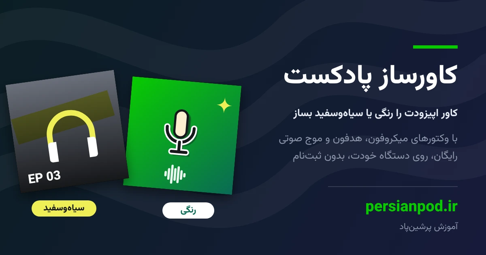

اگر برای پادکستت کاور می‌خواهی، لازم نیست حتماً سراغ نرم‌افزارهای سنگین طراحی بروی. **کاورساز پادکست** یک ابزار فارسی و رایگان است که کمک می‌کند عکس، عنوان و عناصر گرافیکی را کنار هم بچینی و برای پادکست یا اپیزودت تصویر آماده کنی.

ابزار در مرورگر اجرا می‌شود؛ نه ثبت‌نام می‌خواهد و نه لازم است عکس‌هایت را در یک سایت آپلود کنی. می‌توانی مستقیم از نسخه‌ی آنلاین استفاده کنی یا فایل مستقل آن را دانلود کنی و روی دستگاهت نگه داری.

## شروع سریع

<blockquote>
**می‌خواهی همین حالا کاور بسازی؟**

- [باز کردن کاورساز و استفاده‌ی آنلاین](https://persianpod.ir/assets/downloads/podcast-cover-maker/podcast-cover-maker.html)
- [دانلود فایل مستقل برای نگهداری و استفاده‌ی آفلاین](https://github.com/noysdc/persianpod/raw/refs/heads/master/assets/downloads/podcast-cover-maker/podcast-cover-maker.html)
- [مشاهده‌ی فایل برنامه در مخزن GitHub](https://github.com/noysdc/persianpod/blob/master/assets/downloads/podcast-cover-maker/podcast-cover-maker.html)
</blockquote>

**نکته:** لینک اول ابزار را در مرورگر باز می‌کند. لینک دوم فایل HTML برنامه را می‌گیرد؛ آن را روی دستگاهت ذخیره کن و برای اجرا با یک مرورگر به‌روز مثل Chrome یا Edge بازش کن. برای استفاده‌ی آفلاین، فایل دانلودشده باید روی دستگاهت باقی بماند. اجرای فایل محلی روی بعضی گوشی‌ها به سیستم‌عامل و مرورگر بستگی دارد؛ اگر باز نشد، از نسخه‌ی آنلاین استفاده کن.

## با این ابزار چه کارهایی می‌شود کرد؟

- ساخت کاور اصلی پادکست و کاور قسمت‌های مختلف.
- آماده‌کردن تصویر در اندازه‌های مناسب برای پادکست، یوتیوب و شبکه‌های اجتماعی.
- انتخاب حالت رنگی یا سیاه‌وسفید.
- رنگی‌کردن بخش‌هایی از یک عکس سیاه‌وسفید با قلم‌مو.
- اضافه‌کردن نوشته، لوگو و آیکون‌های مرتبط با پادکست.
- ذخیره‌ی طرح با فرمت‌های PNG، JPG و WebP.

## امکانات اصلی

### ۱. عکس و نوشته‌ها را خودت تنظیم کن

عکس موردنظرت را وارد کن و عنوان پادکست یا اپیزود را بنویس. می‌توانی جای عناصر، اندازه و رنگ نوشته‌ها را تنظیم کنی تا طرح خوانا و مرتب باشد.

### ۲. رنگی یا سیاه‌وسفید

برای عکس دو حالت در نظر گرفته شده: رنگی و سیاه‌وسفید. می‌توانی بین آن‌ها جابه‌جا شوی و ظاهر مناسب کارت را انتخاب کنی.

### ۳. قلم‌موی رنگی

اگر دوست داری عکس سیاه‌وسفید باشد اما یک قسمت مشخص رنگی بماند، از قلم‌مو استفاده کن. رنگ، اندازه و نرمی لبه‌ی قلم قابل تنظیم است.

### ۴. آیکون‌ها و شکل‌های آماده

ابزار چند وکتور و نماد مرتبط با پادکست دارد؛ از میکروفون و هدفون تا موج صوتی، پخش و ضبط. می‌توانی آن‌ها را جابه‌جا کنی، بچرخانی، اندازه‌شان را تغییر بدهی و رنگ و شفافیتشان را تنظیم کنی.

### ۵. لوگو و فونت دلخواه

اگر لوگوی پادکستت را داری، می‌توانی آن را به طرح اضافه کنی. فونت پیش‌فرض ابزار وزیرمتن است و امکان بارگذاری فونت دلخواه هم وجود دارد.

### ۶. خروجی برای اندازه‌های مختلف

برای کاور پادکست، تصویر یوتیوب و قالب‌های شبکه‌های اجتماعی می‌توانی اندازه‌ی مناسب را انتخاب کنی. خروجی نهایی را هم با فرمت PNG، JPG یا WebP ذخیره کن.

## چطور از آن استفاده کنم؟

۱. [ابزار را باز کن](https://persianpod.ir/assets/downloads/podcast-cover-maker/podcast-cover-maker.html).

۲. عکس را با انتخاب فایل یا کشیدن آن به محیط ابزار وارد کن.

۳. عنوان پادکست یا اپیزود را بنویس و جای نوشته‌ها را تنظیم کن.

۴. اگر خواستی، حالت سیاه‌وسفید، قلم‌موی رنگی، لوگو یا آیکون‌ها را به کار ببر.

۵. اندازه و فرمت خروجی را انتخاب کن و تصویر را دانلود کن.

لازم نیست از همه‌ی امکانات استفاده کنی. برای یک کاور خوب، معمولاً یک تصویر مناسب، عنوان خوانا و ترکیب‌بندی خلوت کافی است.

## چند پیشنهاد برای کاور بهتر

- عنوان را کوتاه و خوانا نگه دار؛ کاور پادکست در فهرست‌ها معمولاً کوچک دیده می‌شود.
- قبل از خروجی گرفتن، طرح را در اندازه‌ی کوچک هم نگاه کن. اگر نوشته‌ها در آن اندازه خوانا نیستند، ساده‌ترشان کن.
- از چند فونت و رنگ مختلف هم‌زمان استفاده نکن؛ یک هویت بصری ثابت، مجموعه‌ی اپیزودها را حرفه‌ای‌تر و قابل‌شناسایی‌تر می‌کند.
- اگر برای هر قسمت کاور جدا می‌سازی، جای عنوان، رنگ‌ها و سبک کلی را ثابت نگه دار.
- پیش از انتشار، مشخصات فنی و اندازه‌ی موردنیاز پلتفرمی را که در آن منتشر می‌کنی بررسی کن؛ استانداردها ممکن است تغییر کنند.

## آیا عکس‌ها و فایل‌های من جایی ارسال می‌شوند؟

این برنامه برای کار در مرورگر و روی دستگاه خودت طراحی شده است. در نسخه‌ی فعلی، فایل‌های تصویری برای پردازش به سرویس طراحی دیگری آپلود نمی‌شوند. با این حال، اگر می‌خواهی مطمئن شوی، می‌توانی هنگام استفاده اتصال اینترنت را قطع کنی و عملکرد ابزار را آزمایش کنی.

## آیا واقعاً آفلاین است؟

نسخه‌ی مستقل برنامه یک فایل HTML است و کد و فونت اصلی در همان فایل قرار گرفته‌اند؛ بنابراین برای استفاده‌ی معمول به نصب نرم‌افزار جداگانه یا دریافت فونت از اینترنت نیاز ندارد.

برای استفاده‌ی آفلاین:

۱. [فایل مستقل را دانلود کن](https://github.com/noysdc/persianpod/raw/refs/heads/master/assets/downloads/podcast-cover-maker/podcast-cover-maker.html).

۲. فایل را در پوشه‌ای روی دستگاهت نگه دار.

۳. آن را با مرورگر به‌روز باز کن.

۴. اگر ابزار در مرورگر و دستگاهت درست اجرا شد، می‌توانی بدون بازکردن سایت از آن استفاده کنی.

روی کامپیوتر این روش معمولاً سرراست‌تر است. روی گوشی، بازکردن فایل HTML ذخیره‌شده ممکن است به محدودیت‌های مرورگر یا سیستم‌عامل بستگی داشته باشد؛ در این حالت نسخه‌ی آنلاین در دسترس است.

## چند سؤال رایج

**برای استفاده باید حساب بسازم؟**

خیر؛ برای بازکردن و استفاده از ابزار نیازی به ثبت‌نام نیست.

**باید فتوشاپ یا برنامه‌ی دیگری نصب کنم؟**

نه. ابزار در مرورگر اجرا می‌شود و نسخه‌ی دانلودی آن هم یک فایل HTML مستقل است.

**روی گوشی هم می‌توانم کاور بسازم؟**

می‌توانی نسخه‌ی آنلاین را در مرورگر گوشی باز کنی. تجربه‌ی کار با صفحه‌ی کوچک ممکن است به اندازه‌ی نمایشگر و مرورگرت بستگی داشته باشد؛ برای تنظیمات دقیق‌تر، کامپیوتر راحت‌تر است.

**چه فرمتی برای خروجی دارم؟**

PNG، JPG و WebP.

**اگر فایل دانلودی را داشته باشم، باز هم به سایت نیاز دارم؟**

برای اجرای نسخه‌ی مستقل روی دستگاه سازگار، نه. کافی است فایل را نگه داری و با مرورگر باز کنی.

---

این ابزار را برای ساده‌ترشدن کار پادکسترها ساخته‌ایم؛ به این امید که ساخت یک کاور مرتب و قابل‌استفاده، به نرم‌افزار گران یا مهارت حرفه‌ای طراحی وابسته نباشد.

*ساخته‌شده توسط [نویز | NOYS](https://noysdc.ir) برای جامعه‌ی پادکسترهای فارسی‌زبان و همراه با پرشین‌پاد.*
