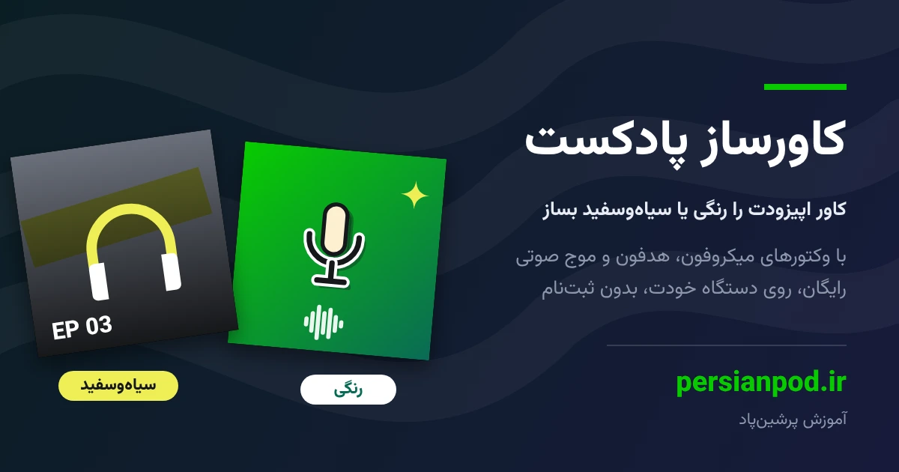

# ابزارهای پرشین‌پاد

ابزارهای کوچک و رایگانی که برای ساده‌ترشدن کار پادکسترها ساخته‌ایم. هدف این است که برای کارهای روزمره، همیشه لازم نباشد سراغ نرم‌افزارهای سنگین یا سرویس‌های پولی بروی.

## کاورساز پادکست

با کاورساز پادکست می‌توانی برای پادکست و اپیزودهایت کاور بسازی؛ عکس و نوشته اضافه کنی، از آیکون‌های آماده استفاده کنی و خروجی تصویر بگیری.

- رایگان و فارسی؛ بدون نیاز به ثبت‌نام
- اجرا در مرورگر، روی کامپیوتر و گوشی
- امکان استفاده از فایل مستقل و نگهداری آن برای استفاده‌ی آفلاین
- خروجی PNG، JPG و WebP
- مناسب ساخت کاور پادکست و تصویرهای شبکه‌های اجتماعی

  <a class="pp-action-btn pp-action-primary" href="/assets/downloads/podcast-cover-maker/podcast-cover-maker.html">اجرای آنلاین کاورساز</a>
  <a class="pp-action-btn pp-action-secondary" href="/assets/downloads/podcast-cover-maker/podcast-cover-maker.html" download="persianpod-podcast-cover-maker.html">دانلود فایل مستقل</a>
  <a class="pp-action-btn pp-action-tertiary" href="/learn/podcast-cover-maker/">راهنمای کامل استفاده</a>

---

فعلاً این بخش با همین ابزار شروع شده است. ابزارهای بعدی را بر اساس نیاز واقعی پادکسترها و تا جای ممکن رایگان، سبک و مستقل انتخاب می‌کنیم.
